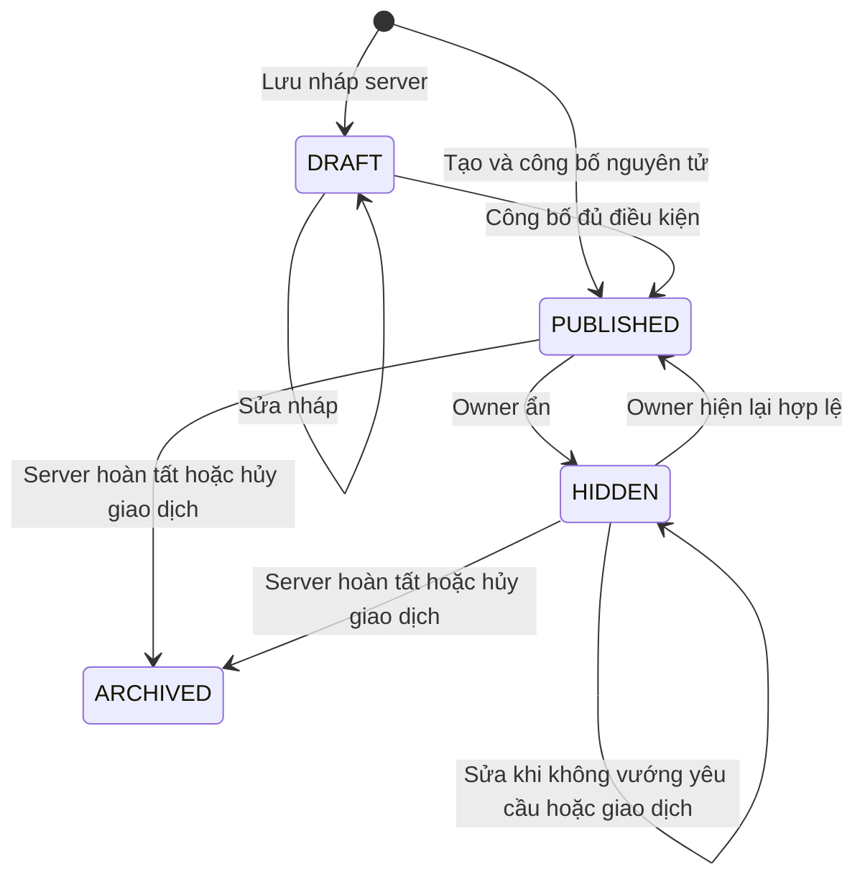

# QUY TẮC NGHIỆP VỤ STUDYSHARE

> **Mã tài liệu:** SS-BR  
> **Phiên bản:** 2.0 – Quy tắc nghiệp vụ hợp nhất và quy ước triển khai MVP  
> **Ngày tổng hợp:** 21/11/2026  
> **Đề tài:** StudyShare – Ứng dụng di động hỗ trợ cho mượn, chuyển nhượng tài liệu học tập và xác thực giao nhận giữa sinh viên  
> **Nhóm:** 12 – 65KTPM, Trường Đại học Thủy lợi  
> **Đầu mối nghiệp vụ và kiến trúc dùng chung:** Nguyễn Văn Trường  
> **Đường dẫn trong repository:** `nhom12-65ktpm/docs/QUY_TAC_NGHIEP_VU.md`

## 0. Đọc trước khi lập trình

**Mục đích:** Tài liệu nghiệp vụ chính thức duy nhất cho cả bốn thành viên: *người dùng làm gì → điều kiện nào được phép → server ghi gì → màn hình thể hiện thế nào → phải kiểm thử ra sao*. Đây không phải báo cáo nghiên cứu quản trị nhân sự và không yêu cầu phát triển hệ thống quản trị quyền riêng tư nhiều cấp trong MVP.

**Cách sử dụng và hiệu lực:** Nội dung dưới đây hợp nhất và cập nhật ngay trong tệp SS-BR hiện hữu, không tạo tài liệu nghiệp vụ tên khác. Tài liệu được biên soạn từ đề cương StudyShare, bản lịch sử `QUY_TAC_NGHIEP_VU.md` v1.2 (SS-BR), `QUY_TRINH_HOAT_DONG.md` (SS-WF), đặc tả của Sơn (SS-SON), quy trình Git và những quyết định nghiệp vụ nhóm trưởng đã xác nhận sau bản v1.2. Những chỗ trước đây còn mở mà cần để lập trình được đã được đưa ra **quy ước triển khai MVP** tại mục 14; đó là lựa chọn biên soạn để nhóm trưởng ban hành, **không phải lời khẳng định cả nhóm đã từng biểu quyết/chốt trước đó**. Quy tắc này là bản do nhóm trưởng chuẩn bị để ban hành; bản trong GitHub chỉ thay đổi sau khi có commit/PR hợp lệ, không mặc định đã được merge.

**Thứ tự ưu tiên sau khi ban hành:** (1) **tệp `QUY_TAC_NGHIEP_VU.md` này** là nguồn quy tắc nghiệp vụ duy nhất; (2) `QUY_TRINH_HOAT_DONG.md` và đặc tả phân hệ bổ sung quy trình chi tiết nếu không mâu thuẫn; (3) đề cương cho mục tiêu, phạm vi, UI và phân công; (4) các bảng trạng thái, schema và API contracts triển khai sau phải tuân thủ quy tắc đã ban hành. **Mọi mô tả trái tài liệu này trong tài liệu cũ cần đồng bộ khi thay đổi code; tuyệt đối không chọn tùy tiện hai quy tắc khác nhau.** Mọi thay đổi nghiệp vụ tiếp theo phải được Trường chấp thuận và được cập nhật vào tệp này trước khi đổi Shared Models/RPC.

**Quy tắc riêng về tác giả:** Tài liệu dùng chung do trưởng nhóm tổng hợp. Việc này **không thay thế** phần UI/domain/repository/test và commit cá nhân của Khanh, Đăng, Sơn.

### 0.1. Phạm vi MVP bắt buộc

- Android, Flutter/Dart, giao diện tiếng Việt, Material 3; Riverpod, go_router; Supabase Auth/PostgreSQL/RLS/private Storage; SQLite/Drift cho bản nháp và ảnh offline. Chỉ Android, không Web.
- Đăng nhập và hồ sơ; bản sách vật lý `Material` + lần đăng `Listing`; ảnh bìa, QR riêng; khám phá/lọc; yêu cầu mượn/tặng/bán và phê duyệt nguyên tử.
- BORROW: giao, theo dõi hạn, trả trực tiếp/qua C; DONATE: chuyển chủ khi B nhận; SELL: thanh toán ngân hàng ngoài ứng dụng, A xác nhận tiền **trước mọi bàn giao SELL**.
- Handover: QR hoặc fallback hợp lệ, ảnh do người giao, người nhận chỉ định xác nhận, server ACK mới chuyển holder; giao hộ do C ứng tuyển/người tạo chọn; lịch sử, tình huống thất bại, Issue tối thiểu; ảnh offline không xác nhận giả.
- Một bản demo trọn vẹn: **A đăng → B yêu cầu → A duyệt → A/C bàn giao có ảnh → B nhận → B trả → A xác nhận → COMPLETED**.

### 0.2. Không làm trong MVP

Không đổi sách lấy sách, chat thời gian thực, theo dõi GPS liên tục, cổng thanh toán/đối soát ngân hàng tự động, ví nội bộ, chuyển tiền/hoàn tiền tự động, nền tảng Web, hệ thống trọng tài có quyền đơn phương xử lý tranh chấp, quy trình BOOT/PRIV nhiều cấp, xuất bằng chứng nhạy cảm nâng cao nếu chưa có đủ phân quyền và kiểm thử. **Không thêm các mục này vào điều kiện nghiệm thu chức năng cốt lõi.**

---

## 1. Vai trò và thuật ngữ

- **A:** chủ sở hữu/người đăng tài liệu ở thời điểm tạo giao dịch, người cho mượn/tặng/bán. Trong giao dịch đã tạo, định danh A được lưu snapshot; chuyển chủ thành công không viết lại A của lịch sử.
- **B:** người yêu cầu mượn/nhận tặng/mua và là người cuối nhận tài liệu trong chiều đi.
- **C:** sinh viên giao hộ được lựa chọn cho **một** `DeliveryTask`; ở chiều trả có thể là C khác với chiều đi. C không phải loại tài khoản cố định.
- **Material:** **một bản vật lý duy nhất**, có `material_id` và QR riêng; hai sách cùng ISBN/tên vẫn có ID khác nhau.
- **Listing:** một lượt đăng của Material, với đúng **một** `offer_type` là `BORROW`, `DONATE` hoặc `SELL`.
- **ExchangeRequest:** đơn yêu cầu một Listing, trước khi A duyệt.
- **Transaction:** giao dịch đã được chấp thuận, có loại, A/B, tình trạng, điều kiện đã snapshot, những chặng giao nhận.
- **BorrowingRecord:** thông tin số ngày mượn, `started_at`, `due_date`, các mốc giao trả và hoàn tất của BORROW.
- **DeliveryTask / DeliveryApplication:** nhiệm vụ giao hộ và ứng tuyển của C; một Task chỉ có tối đa một C được chọn ở một thời điểm.
- **Handover:** một chặng X → Y, gồm đối chiếu QR, ảnh do X cung cấp, **Y tự xác nhận**, server ghi nhận kết quả.
- **Issue:** vụ việc về sai sách, bất đồng, giao thất bại, không hợp tác, v.v.; **Issue không tự thay đổi lịch sử vật lý**.
- **`owner_id`:** người sở hữu trên StudyShare; **`holder_id`:** người giữ được ghi nhận qua **Handover hợp lệ gần nhất**. Holder không phải khẳng định tuyệt đối ai đang cầm ngoài đời nếu có tranh chấp.
- **TransactionEvent:** sự kiện server có actor, thời điểm, nguồn thao tác; thông báo và timeline đọc từ đây.

Một người dùng có thể là A ở giao dịch này, B ở giao dịch khác, C ở giao dịch khác. Quyền kiểm tra **theo quan hệ với giao dịch/chặng**, không chỉ theo loại tài khoản.

## 2. Các bất biến bắt buộc ở server

| Mã | Bất biến phải đúng với mọi UI, Mock và Supabase RPC |
|---|---|
| INV-01 | Một Material có tối đa **một Transaction ACCEPTED đang hoạt động**. Nhiều Request PENDING được phép, chỉ một Request ACCEPTED. |
| INV-02 | Duyệt Request = **một thao tác nguyên tử**: duyệt 1, từ chối PENDING cạnh tranh, khóa Material, tạo Transaction, snapshot thỏa thuận, ghi Event. |
| INV-03 | Không có `setOwner`, `setHolder`, `setStatus('COMPLETED')` tổng quát cho Flutter. Chủ/giữ/trạng thái là hệ quả của lệnh nghiệp vụ qua server. |
| INV-04 | Mỗi Handover có ≥1 ảnh **do người giao chụp/gửi**, đúng mã tài liệu/chặng, người nhận chỉ định tự xác nhận, server ACK; thiếu bất kỳ điều kiện nào không đổi holder. |
| INV-05 | **QR đã đọc nhưng sai** phải chặn chặng đó; không được chuyển sang manual để bỏ qua. QR thiếu/không đọc được mới được fallback có ghi lý do. |
| INV-06 | BORROW không đổi owner; `started_at` chỉ bắt đầu khi B nhận cuối hợp lệ; `COMPLETED` chỉ sau A nhận trả cuối hợp lệ. |
| INV-07 | DONATE đổi owner sang B sau B xác nhận nhận cuối. SELL đổi owner sang B **chỉ** sau A đã xác nhận nhận tiền trước mọi Handover và B xác nhận nhận cuối. |
| INV-08 | C giao thất bại: holder tiếp tục là C nếu chặng C nhận đã hợp lệ; không tự trả về A/B, không tự giải phóng Material. |
| INV-09 | Ảnh chụp/local draft/offline không được coi đã upload/CONFIRMED. Retry không tạo giao dịch, holder update hay event trùng. |
| INV-10 | Không có Issue hoặc admin nào tự giải quyết Transaction, đổi owner/holder, ghi nhận hoàn tiền hay xác nhận vật lý thay người liên quan. |
| INV-11 | Listing cũ `ARCHIVED` sau hoàn tất/hủy; đăng lại tạo Listing mới với cùng Material/QR, không khôi phục Listing cũ. |
| INV-12 | `auth.uid()` và mọi quyền được kiểm tra ở server; ảnh Handover nằm trong private Storage; không chứa `service_role` trong APK/repository. |

---

## 3. Material, Listing, tìm kiếm và yêu cầu

### 3.1. Đăng và quản lý bản sách

1. A đăng nhập, tạo `Material` nếu là bản vật lý mới; cung cấp tên, môn/loại và tình trạng. Khi công bố Listing cần **tối thiểu một ảnh** đã ghi nhận và chọn đúng một hình thức; SELL phải có giá nguyên VND >0. Tên/ISBN có thể trùng bản khác.
2. Server tạo `material_id`/QR định danh riêng; Listing bắt đầu `DRAFT` hoặc `PUBLISHED`. Một Material không có hai Listing hiện hành cạnh tranh.
3. Chỉ owner hiện tại được sửa/ẩn; khi đã có giao dịch đang hoạt động không được đổi hình thức, giá hoặc điều kiện đã snapshot.
4. Listing `PUBLISHED` nhưng Material đã `RESERVED` **vẫn hiển thị với nhãn “Đã được đặt”**; vô hiệu nút gửi yêu cầu và server từ chối tạo yêu cầu mới. `ARCHIVED` bị ẩn khỏi khám phá bình thường.
5. Sau BORROW hoàn tất, owner A vẫn sở hữu Material, holder A, Listing cũ `ARCHIVED`. Muốn tiếp tục cho mượn phải tạo Listing mới; **reuse QR**.
6. Sau DONATE/SELL hoàn tất, owner mới B có quyền tạo Listing mới cho cùng Material; không được sửa Listing lịch sử của A.

**MVP thống nhất:** Thông tin khu vực nhận sách của người yêu cầu không phải trường bắt buộc ở UI gửi Request; ghi điểm hẹn tại lúc chọn bàn giao. Không lấy GPS âm thầm để sắp hàng yêu cầu.

### 3.1.1. Bổ sung Material ngày 2 — Trường duyệt 25/11/2026

- Material chưa đăng tin được lưu với 0–5 ảnh; công bố Listing cần ít nhất 1 ảnh đã được server xác thực và gắn vào Material. JPEG/PNG/WebP, tối đa 5 MiB/ảnh; ảnh đầu là bìa.
- Tên 1–200, môn/loại và tình trạng 1–100 ký tự sau trim; mô tả bản sách tùy chọn tối đa 2.000 ký tự; ISBN tùy chọn, nếu nhập phải đúng ISBN-10/13 và không unique. Không cho ký tự điều khiển trong văn bản.
- Chỉ owner sửa metadata/ảnh khi không có Transaction active, owner đang là holder, không có Listing PUBLISHED hoặc Request PENDING. Ẩn tin và xử lý yêu cầu chờ trước khi sửa.
- Sửa dùng revision để chặn ghi đè đồng thời; retry cùng key/payload trả cùng kết quả. Client confirm trước tạo/sửa, gỡ ảnh và bỏ thay đổi. Local draft không phải ACK server.
- Chủ mới quản lý ảnh theo Material, không phụ thuộc người upload. Ảnh lịch sử còn được snapshot tham chiếu phải được giữ khi gỡ khỏi gallery.

### 3.1.2. Đặc tả Listing ngày 3 cho Trường

Luồng SCR-10, tab Đăng tin, kiểm tra đầu vào, quyền, trạng thái và dữ liệu bàn giao SCR-06 được quy định tại [Phụ lục B](#phụ-lục-b-đặc-tả-nghiệp-vụ-ngày-3-cho-trường). Trường đã đồng ý đặc tả và N3-D01–N3-D08 ngày 26/11/2026; contract triển khai được ghi tại CONTRACTS §15.

### 3.2. Request và phê duyệt

- B không thể gửi Request cho Material của mình, không tạo nhiều Request `PENDING` trùng cùng Listing; Request chỉ được tạo nếu Listing `PUBLISHED` và Material còn khả dụng.
- BORROW: B đề xuất **số ngày nguyên từ 1 đến 30**, A **chấp nhận đúng số đó hoặc từ chối**; không thương lượng/gia hạn trong MVP.
- Mỗi Request ghi `created_at` từ server; danh sách A xem thời điểm gửi, mặc định sắp cũ nhất trước để tiện xem, **không ép FIFO**; A được chọn bất kỳ yêu cầu hợp lệ.
- Khi A duyệt một Request: server nguyên tử đặt Request này `ACCEPTED`, Request PENDING khác `REJECTED/MATERIAL_UNAVAILABLE`, tạo **một** Transaction, giữ chỗ Material, ghi Event. Client không tự optimistic update là ACCEPTED nếu chưa ACK.
- B được rút Request khi vẫn `PENDING` → `CANCELLED`; sau `ACCEPTED`, không được sửa Request ngược về PENDING/CANCELLED, phải áp dụng hủy Transaction theo mục 10.

---

## 4. Handover – quy trình duy nhất dùng lại ở mọi chặng

Các chặng đi, trả, nhận/giao hộ **đều dùng cùng một quy trình**. Bên giao là người đang được server ghi holder; người nhận là tài khoản đích đã được chỉ định.

| Bước | Ai | Điều kiện/đầu ra |
|---|---|---|
| H1 | Server | Tạo Handover có ID ổn định; liên kết Transaction, Material, `from_user_id`, `to_user_id` và chặng liên quan. Không tạo hai Handover đang hoạt động cho cùng chặng. |
| H2 | Người giao | Quét QR Material, đối chiếu hợp lệ; nếu QR thiếu/không đọc được, dùng QR Handover hoặc manual có lý do ghi vào server. QR **đọc được mà sai** → `QR_MISMATCH`, chặn. |
| H3 | Người giao | Chụp và tải lên ít nhất 1 ảnh bằng camera; Evidence được ghi vào private Storage và server xác thực đúng Handover. |
| H4 | Server | Chỉ sau H2 hợp lệ và Evidence đã upload/ghi nhận đủ mới chuyển Handover sang `AWAITING_RECEIVER_CONFIRMATION`. |
| H5 | Người nhận chỉ định | Kiểm tra tài liệu, ảnh, người giao, rồi **Xác nhận đã nhận** hoặc **Từ chối/Báo vấn đề** với lý do. |
| H6a | Server | Khi nhận hợp lệ, nguyên tử Handover → `CONFIRMED`, holder = receiver, ghi Event, cập nhật trạng thái Transaction/DeliveryTask có liên quan. |
| H6b | Server | Khi người nhận từ chối trước nhận: `DISPUTED`, tạo Issue, **không** đổi holder/owner. Ảnh bổ sung của người từ chối là tùy chọn. |

**Quy ước triển khai để không phải hỏi tiếp:** Handover `DISPUTED` được giữ nguyên làm lịch sử; sau khi Issue có phương án giải quyết hợp lệ, nếu cần bàn giao lại thì **tạo Handover ID mới**, không sửa lượt bị từ chối thành CONFIRMED. Các nút Retry mạng phải dùng chính action ID để chống ghi trùng; retry sự kiện nghiệp vụ đã hoàn tất trả về trạng thái server hiện tại.

**QR:** QR Material xác thực `material_id` bằng token không dễ đoán, không dùng ISBN thay ID. QR của chặng gắn với `handover_id` và server kiểm tra quan hệ, trạng thái, actor; **QR/UUID một mình không phải bằng chứng người đã nhận**. Token và phiên bản được phát hành/kiểm tra ở server; TTL chi tiết có thể cấu hình và không làm thay đổi quy tắc ảnh + người nhận + ACK. Màn hình có nhãn rõ: `Chưa gửi`, `Chờ người nhận`, `Đã xác nhận`, `Bị từ chối`.

**Offline:** Chỉ lưu file trong vùng riêng tư của app, metadata nháp và action ID; không lưu quyền truy cập ảnh trong public directory, không tự tạo Handover server khi offline. Upload/retry trong lúc app chạy; xóa file nháp chỉ sau ACK thích hợp. Không hứa dịch vụ đồng bộ nền liên tục.

---

## 5. BORROW – mượn, hạn trả, hoàn trả

### 5.1. Chiều giao tài liệu

1. A duyệt Request BORROW 1–30 ngày; Transaction chờ giao; owner và holder ban đầu vẫn là A.
2. Chọn **trực tiếp A→B** hoặc **giao hộ A→C→B**; mỗi chặng có Handover riêng theo mục 4.
3. Chỉ khi B xác nhận nhận cuối thành công và server ACK: `holder=B`, Transaction vào giai đoạn `BORROWING`, lưu `started_at` server. Mượn **không bắt đầu** khi A mới duyệt hoặc C mới lấy sách.
4. `due_date` là **ngày Việt Nam** tại lúc B nhận hợp lệ cộng số ngày mượn đã được chấp thuận. Ví dụ nhận ngày 21/11/2026, mượn 7 ngày → hạn cuối 28/11/2026 (hết ngày theo `Asia/Ho_Chi_Minh`); `OVERDUE` bắt đầu 29/11/2026, không thay Transaction.status.

### 5.2. Chiều trả tài liệu

1. B tạo yêu cầu trả; ý định trả chỉ tạo lịch sử, **không** đổi holder, không tự hoàn tất, không tự dừng tính trễ.
2. B trả **trực tiếp B→A** hoặc mở **DeliveryTask trả B→C→A**. Người tạo Task chiều trả là B (người đang gửi sách); A được thông báo nhưng **không cần phê duyệt trước C**.
3. Nếu B→A thành công trước/cuối hạn, ghi mốc trả thực tế. Nếu B→C hợp lệ vào hoặc trước due_date, ghi mốc **B đã bàn giao cho người giao hộ được chọn** để không tiếp tục cộng trễ mượn gốc do A chậm/không nhận từ C; giữ nguyên due_date và bằng chứng.
4. Transaction **chỉ `COMPLETED`** khi A cuối cùng xác nhận Handover nhận lại; cập nhật holder=A, owner=A, Listing cũ ARCHIVED, không công khai lại.
5. Nếu A im lặng hoặc từ chối hợp tác, B ghi nhận ý định, lần liên hệ và mở Issue; **không tự xác nhận trả, không đóng băng due_date, không tự chuyển holder**. Lỗi và trách nhiệm chậm trả sẽ được giải quyết riêng, không tự phạt B nếu không đủ căn cứ.

### 5.3. Courier trả thất bại, 3 ngày tái bàn giao

- Khi B→C đã CONFIRMED nhưng C không giao A được, C phải trả **C→B** bằng Handover mới, ảnh người giao C và B xác nhận. Chỉ khi đó holder mới trở về B.
- B có **3 ngày lịch Việt Nam** từ ngày server xác nhận C→B để thực hiện lượt **tái bàn giao đầu tiên hợp lệ** đến A hoặc C mới được chọn; hạn cuối là cuối ngày `ngày_nhận_lại + 3`. Đây là **hạn tái bàn giao**, không viết đè `due_date` mượn gốc hoặc mốc trả ban đầu B→C.
- Quá hạn tái bàn giao hiển thị riêng `REHANDOVER_OVERDUE`, không tự tính lại trễ mượn gốc hay hoàn tất giao dịch.

---

## 6. DONATE – tặng miễn phí

1. A đăng Listing DONATE, B gửi Request, A duyệt nguyên tử.
2. Giao trực tiếp A→B hoặc A→C→B; mọi chặng ảnh + xác nhận receiver.
3. Khi **B xác nhận nhận cuối** và server ACK: `holder=B`, `owner=B`, Transaction `COMPLETED`, Listing A `ARCHIVED`, Event chỉ ghi một lần.
4. Không có thanh toán, không có bước trả. B có thể đăng Listing mới cho Material mình đã nhận; không tái sử dụng Listing cũ của A.
5. Nếu B từ chối trước nhận hoặc báo Issue sau nhận: áp dụng mục 9; không tự chuyển chủ nếu từ chối, không tự đảo ngược chủ khi đã nhận hợp lệ.

## 7. SELL – chuyển nhượng có tiền ngoài ứng dụng

**Thứ tự bắt buộc (đã được nhóm trưởng chốt sau SS-BR v1.2):**

`B gửi Request → A duyệt → B thấy QR/thông tin chuyển khoản → B chuyển tiền ngoài app → A tự kiểm tra và bấm Đã nhận tiền → mới cho Handover đầu tiên của SELL → B xác nhận nhận cuối → chuyển chủ và COMPLETED`.

- Mã QR **ngân hàng** khác QR Material và QR Handover; chỉ hiển thị **sau A duyệt**, dùng thông tin A khai báo, số tiền snapshot, mã tham chiếu; không lưu mật khẩu/OTP, không tự kiểm tra giao dịch thật.
- `buyer_reported_at`/nút “Tôi đã chuyển khoản” **chỉ là thông báo**, không đủ để giao sách; chỉ `seller_confirmed_at` do A xác nhận sau kiểm tra ngoài app mới mở khóa tạo/gửi **bất kỳ Handover SELL**.
- Có thể thỏa thuận điểm hẹn, tạo DeliveryTask và chọn C trước khi A xác nhận tiền, nhưng **không cho Handover A→C/A→B hoặc các chặng tiếp theo được thực thi trước khi A xác nhận tiền**.
- Sau A xác nhận tiền nhưng chưa có B nhận cuối: `owner=A`, `holder` vẫn là người nhận hợp lệ gần nhất, Transaction chưa hoàn tất. Khi B nhận cuối hợp lệ: server **nguyên tử** owner=B, holder=B, Transaction COMPLETED, Listing cũ ARCHIVED.
- **Không có happy path “giao sách SELL trước tiền”.** Nếu việc đó xảy ra ngoài hệ thống hoặc do dữ liệu cũ: ghi Issue để đối soát, **không cho tự hợp thức hóa bằng cách đổi trạng thái**.
- C giao SELL thất bại, sách trả lại A hợp lệ: A có thể **đề nghị tiếp tục** (hẹn giao mới/đổi C) hoặc **đề nghị hủy và hoàn tiền**. Việc hủy cần B đồng ý, A hoàn tiền **ngoài ứng dụng**, B xác nhận thực nhận tiền hoàn, sách đã ở A, không có Issue/ nghĩa vụ mở; không hủy/hoàn tiền một phía.

---

## 8. DeliveryTask – giao hộ, ứng tuyển và thất bại

1. Người đang giữ và cần gửi tài liệu tạo Task: chiều đi A→B do A; chiều trả B→A do B. Nhập **mô tả điểm lấy/điểm giao bắt buộc**; tọa độ GPS tùy chọn khi người dùng cho phép. Không tracking C liên tục.
2. C đăng nhập, tự ứng tuyển Task. C phải khác người gửi và người nhận cuối **của Task**.
3. Người tạo Task xem danh sách ứng viên và **chọn thủ công đúng một C**. Server nguyên tử ghi ứng viên C `ACCEPTED`, các đơn PENDING khác `REJECTED`, Task `ASSIGNED`; không tự chọn theo rating.
4. Chặng H1 người gửi→C: **người gửi** chụp/upload ảnh, C xác nhận; Handover CONFIRMED mới `holder=C` và Task `PICKED_UP`.
5. Chặng H2 C→người nhận cuối: **C** chụp/upload ảnh, người nhận cuối xác nhận; thành công mới Task `COMPLETED` và đổi holder.
6. **Quy ước MVP để tránh kẹt Task:** Trước khi H1 CONFIRMED, ứng viên PENDING có thể tự rút; C đã được chọn có thể xin rút phân công trước nhận, Task cũ được hủy có audit/lý do và người tạo lập Task mới để tuyển C khác. **Sau khi C đã nhận sách**, không có nút hủy nhanh: dùng quy trình giao thất bại và bàn giao trả.
7. Nếu C đã nhận sách nhưng không giao được: ghi `FAILED` với lý do, mở Issue khi cần, `holder` **vẫn C**. C phải giao trả về **người đã trực tiếp giao sách cho C** bằng Handover mới, không phải luôn luôn A: chiều đi là **C→A**, chiều trả là **C→B**.
8. Task `FAILED` giữ trạng thái lịch sử; khi sách đã hoàn trả hợp lệ, ghi `return_handover_id`/event `COURIER_RETURN_CONFIRMED`, **không tự sửa Task FAILED thành COMPLETED**. Chuyến mới (nếu tiếp tục) tạo Task mới, không tái sử dụng ảnh/chặng cũ.
9. A và B được đánh giá C **1–5 sao, mỗi người tối đa một lần mỗi Task**, tùy chọn sau khi Task kết thúc và Issue liên quan đã được giải quyết. Hiển thị trung bình + số lượt, chưa có thì ghi “Chưa có đánh giá”. Không trừ sao tự động vì sự cố. Rating là chức năng phụ, không chặn demo bàn giao.

---

## 9. Từ chối, khiếu nại và Issue

### 9.1. Từ chối **trước khi nhận hợp lệ**

- Người nhận đúng chặng từ chối vì sai tài liệu/không đúng tình trạng/chưa nhận: phải ghi **lý do**, ảnh bổ sung có thể kèm. Server Handover → `DISPUTED`, Issue mở, **không đổi holder/owner**, không được coi Handover hoàn tất.
- QR sai đã đọc được **chặn từ đầu**, không cho manual override hoặc xác nhận nhận. Khi các bên thống nhất phương án xử lý Issue, nếu cần thực hiện lại thì tạo Handover mới.

### 9.2. Khiếu nại **sau khi đã nhận hợp lệ**

- B có thể báo vấn đề sau khi nhận; Issue **không đảo ngược** Handover, `holder`, `owner`, payment hay `COMPLETED`.
- Khiếu nại về tình trạng tại lúc nhận B phải được **mở trong 7 ngày lịch Việt Nam** kể từ ngày server xác nhận B nhận cuối. Ví dụ B nhận 24/11 → nhận phản ánh đến hết **01/12**.
- Đối với BORROW, vấn đề mới phát sinh được báo **trong suốt giao dịch còn hoạt động**. Sau BORROW `COMPLETED`, có thể mở Issue về chặng trả trong **7 ngày lịch Việt Nam** từ ngày A xác nhận trả cuối; đồng thời vẫn giữ cửa sổ khiếu nại 7 ngày của B từ lúc nhận ban đầu nếu chưa hết.
- Issue mở đúng hạn **không tự hết hiệu lực** sau mốc 7 ngày; ngày cuối chỉ là hạn **khởi tạo** theo loại khiếu nại. Với DONATE/SELL đã hoàn tất, không tự trả hàng/hoàn tiền/hủy giao dịch chỉ vì Issue sau nhận.
- Mở Issue không tự dừng hoặc kéo dài hạn trả BORROW. Cần giữ lịch sử mốc trả để phân biệt quá hạn và lỗi do người nhận không hợp tác.

### 9.3. Quyền giải quyết và trạng thái

- Issue có trạng thái **`OPEN`, `RESOLVED`** cho MVP; có thể lưu loại, đối tượng, reporter, nội dung, diễn biến, giải pháp đề xuất và xác nhận các bên liên quan. `NEEDS_RESOLUTION` là **nhãn UI suy ra từ Issue đang OPEN**, không phải `Transaction.status` độc lập.
- Chỉ **các bên trực tiếp bị ảnh hưởng** đồng thuận xác nhận phương án xử lý mới chuyển Issue `RESOLVED`; moderator/APP_ADMIN (nếu có) chỉ hỗ trợ, không đơn phương xác nhận đã giao, đổi chủ, chuyển tiền hay đóng Issue.
- Nếu A nhiều lần cản trở nhận trả, B có thể yêu cầu hỗ trợ/hòa giải; không có quyền hỗ trợ tự thay đổi holder, owner, payment hoặc trạng thái hoàn tất. Nếu các bên không thống nhất, hồ sơ tiếp tục OPEN; không tự đóng sau một timeout.
- Các hành động nghiệp vụ xung đột với Issue OPEN phải bị chặn; các thao tác thực hiện nghĩa vụ trả/khôi phục an toàn cần được phép theo phương án các bên đồng thuận, không khóa toàn bộ giao dịch một cách mù quáng.

---

## 10. Hủy Request, Transaction và khắc phục SELL

- **Request trước duyệt:** B được tự rút nếu còn `PENDING`; `CANCELLED` ghi timestamp server. A có thể `REJECTED` Request đang PENDING.
- **Transaction đã được duyệt:** một bên A hoặc B đề nghị hủy, có lý do; **bên còn lại phải đồng ý**. Không cho hủy nhanh một phía.
- Server chỉ được chuyển `CANCELLED` khi bảo đảm **không còn sách đang cần giao/hoàn trả, không còn tiền phải đối soát/hoàn trả, không có Issue OPEN**. Nếu đã phát sinh Handover hoặc thanh toán, hoàn thành các bước vật lý/tiền hợp lệ trước, không xóa lịch sử cũ.
- Khi hủy hợp lệ: cập nhật Transaction `CANCELLED`, giải phóng khóa Material khi an toàn, **Listing cũ ARCHIVED** (không tự đăng lại), ghi Event, tất cả nguyên tử. Không thay holder/owner tùy ý.
- SELL tiền đã xác nhận nhưng giao không hoàn tất: hướng **tiếp tục** hoặc **đề nghị hủy/hoàn tiền** cần A/B đồng thuận; hoàn tiền ngoài app; B độc lập xác nhận nhận đủ tiền hoàn, sách do A giữ hợp lệ; chỉ khi hết nghĩa vụ và Issue thì mới được hủy.

---

## 11. Trạng thái canonical và quy tắc chuyển

**Các enum dưới đây là quy ước triển khai MVP trong tệp SS-BR này, dùng làm chuẩn cho Shared Models, Mock và SQL sau khi nhóm trưởng ban hành tệp này.** Không dùng status cho một ý nghĩa khác giữa các phân hệ.

| Đối tượng | Trạng thái lưu trữ chuẩn | Ghi chú |
|---|---|---|
| `Listing.status` | `DRAFT`, `PUBLISHED`, `HIDDEN`, `ARCHIVED` | `RESERVED` không phải Listing.status. |
| `ExchangeRequest.status` | `PENDING`, `ACCEPTED`, `REJECTED`, `CANCELLED` | `CANCELLED` chỉ áp dụng trước duyệt. |
| `Transaction.status` – BORROW | `AWAITING_HANDOVER`, `HANDOVER_IN_PROGRESS`, `BORROWING`, `RETURN_PENDING`, `RETURN_IN_PROGRESS`, `COMPLETED`, `CANCELLED` | `OVERDUE`, `NEEDS_RESOLUTION` là nhãn dẫn xuất. |
| `Transaction.status` – DONATE | `AWAITING_HANDOVER`, `HANDOVER_IN_PROGRESS`, `COMPLETED`, `CANCELLED` | Điều kiện tiền không áp dụng. |
| `Transaction.status` – SELL | `AWAITING_PAYMENT`, `AWAITING_HANDOVER`, `HANDOVER_IN_PROGRESS`, `COMPLETED`, `CANCELLED` | `AWAITING_PAYMENT` cho đến khi A xác nhận tiền; không có Handover trước đó. |
| `Handover.status` | `PENDING`, `AWAITING_RECEIVER_CONFIRMATION`, `CONFIRMED`, `DISPUTED` | `DISPUTED` giữ nguyên, retry bằng Handover mới sau phương án xử lý. |
| `DeliveryTask.status` | `OPEN`, `ASSIGNED`, `PICKED_UP`, `DELIVERY_PENDING_CONFIRMATION`, `COMPLETED`, `FAILED`, `CANCELLED` | FAILED vẫn FAILED sau sự kiện trả hợp lệ; không giả hoàn tất task. |
| `DeliveryApplication.status` | `PENDING`, `ACCEPTED`, `REJECTED`, `WITHDRAWN` | Chỉ một ACCEPTED mỗi Task. |
| `Issue.status` | `OPEN`, `RESOLVED` | Không tự `CLOSED` nếu chưa có quy trình mới. |
| `Material availability` | **Dẫn xuất** từ Listing, Transaction và holder | UI không set `AVAILABLE`, `RESERVED`, `ON_LOAN` tùy ý. |

### 11.1. Ma trận transition (lệnh nghiệp vụ, không phải set status)

| Từ → đến | Lệnh hoặc sự kiện | Rào chắn và tác động chính |
|---|---|---|
| Listing `DRAFT → PUBLISHED` | Owner `publishListing` | Ảnh, tên, môn/loại, tình trạng và hình thức hợp lệ; SELL giá >0. |
| Listing `PUBLISHED ↔ HIDDEN` | Owner ẩn/hiện | Không phá thỏa thuận giao dịch đã duyệt. |
| Listing hiện hành `→ ARCHIVED` | Hoàn tất/hủy Transaction | Giữ lịch sử, không công khai lại. |
| Request `PENDING → ACCEPTED` | A duyệt | Một RPC nguyên tử, các request cạnh tranh REJECTED, tạo T. |
| Request `PENDING → REJECTED/CANCELLED` | A từ chối/B rút | Đúng actor; không tạo T. |
| BORROW `AWAITING_HANDOVER → HANDOVER_IN_PROGRESS` | Tạo Handover chiều đi | Đúng holder, đúng transaction; không tự BORROWING. |
| BORROW `HANDOVER_IN_PROGRESS → BORROWING` | B xác nhận nhận cuối | Bắt đầu kỳ mượn/tính due_date. |
| BORROW `BORROWING → RETURN_PENDING` | B yêu cầu trả | Chỉ ghi ý định, không đổi holder. |
| BORROW `RETURN_PENDING → RETURN_IN_PROGRESS` | Chặng trả đầu tiên | Không hoàn tất khi mới B→C. |
| BORROW `RETURN_IN_PROGRESS → COMPLETED` | A xác nhận nhận cuối | Holder=A, owner=A, archive Listing. |
| SELL `AWAITING_PAYMENT → AWAITING_HANDOVER` | A xác nhận đã nhận tiền | A là người bán, server ghi nhận một lần. |
| DONATE/SELL `AWAITING_HANDOVER → HANDOVER_IN_PROGRESS` | Chặng đầu giao tài liệu | SELL đã phải có seller_confirmed_at. |
| DONATE/SELL `HANDOVER_IN_PROGRESS → COMPLETED` | B nhận cuối | DONATE: owner=B; SELL: kiểm tra tiền có từ trước; archive Listing. |
| Handover `PENDING → AWAITING_RECEIVER_CONFIRMATION` | Người giao upload ≥1 ảnh + đối chiếu đúng | Ảnh đã server ACK; QR mismatch chặn. |
| Handover `AWAITING_RECEIVER_CONFIRMATION → CONFIRMED` | Người nhận xác nhận | Holder=receiver nguyên tử, event một lần. |
| Handover `AWAITING_RECEIVER_CONFIRMATION → DISPUTED` | Người nhận từ chối | Lý do + Issue, không holder change. |
| DeliveryTask `OPEN → ASSIGNED → PICKED_UP` | Người tạo chọn C; H1 xác nhận | One courier; holder=C sau H1. |
| DeliveryTask `PICKED_UP → DELIVERY_PENDING_CONFIRMATION → COMPLETED` | C gửi ảnh; receiver xác nhận | Holder cuối được cập nhật sau ACK. |
| DeliveryTask sau C đã lấy `→ FAILED` | Báo giao thất bại | Giữ holder=C, Issue hoặc lý do, cần Handover trả riêng. |
| Transaction active `→ CANCELLED` | Đề nghị + đồng ý hủy | Không còn nghĩa vụ sách/tiền/Issue; archive Listing nguyên tử. |
| Issue `OPEN → RESOLVED` | Các bên bị ảnh hưởng xác nhận phương án | Không cho moderator/admin tự xác nhận thay. |

**Chú ý chuỗi dài:** Sau khi C giao không thành, lượt Handover trả về người giao trước là một **Handover phục hồi** thuộc cùng Transaction, không bị ép phải hợp thức hóa bằng một transition BORROWING giả. Sơn tính trạng thái tổng từ các Event/Handover; Đăng không tự set Transaction.status.

---

## 12. Dữ liệu tối thiểu, server contracts và lỗi

### 12.1. Các thực thể cần dùng chung

| Thực thể | Trường logic tối thiểu để thiết kế database / model |
|---|---|
| `Profile` | `user_id`, `display_name`, thông tin chia sẻ có quyền, `created_at`. |
| `Material` | `id`, `owner_id`, `holder_id`, `qr_token` (không public token nhạy cảm), `title`, `subject`, `condition`, `isbn?`, ảnh bìa, `created_at`. |
| `Listing` | `id`, `material_id`, `offer_type`, `status`, `asking_price_vnd?`, `published_at`, snapshot các thuộc tính công bố. |
| `ExchangeRequest` | `id`, `listing_id`, `requester_id`, `requested_borrow_days?`, `status`, `created_at`, `decided_at`, `reject_reason?`. |
| `Transaction` | `id`, `listing_id`, `request_id`, `type`, `owner_at_acceptance`, `receiver_id`, `status`, `agreed_borrow_days?`, `agreed_price_vnd?`, timestamps. |
| `BorrowingRecord` | `transaction_id`, `started_at`, `due_date`, `return_to_courier_at?`, `final_return_confirmed_at?`, `re_handover_due_date?`. |
| `DeliveryTask` | `id`, `transaction_id`, `sender_id`, `final_receiver_id`, `assigned_courier_id?`, `status`, pickup/dropoff description, optional coords, recovery handover. |
| `DeliveryApplication` | `id`, `task_id`, `applicant_id`, `status`, `created_at`. |
| `Handover` | `id`, `transaction_id`, `delivery_task_id?`, `from_user_id`, `to_user_id`, `status`, `verification_method`, fallback reason, server timestamps. |
| `HandoverEvidence` | `id`, `handover_id`, uploader, private storage path, server time, sensitivity metadata. |
| `PaymentConfirmation` | `transaction_id`, price snapshot, seller, buyer_reported_at?, seller_confirmed_at?, refund_proposed_at?, buyer_refund_confirmed_at?`. |
| `Issue` | `id`, `transaction_id`, `handover_id?`, reporter, reason/type, status, opened_at, resolved_at?, resolution/consents. |
| `TransactionEvent` | `id`, `transaction_id`, actor, event type, server timestamp, `source_action_id` idempotency key, safe details. |
| `CourierRating` | task ID, rater ID, stars 1–5, timestamp; UNIQUE(task_id,rater_id). |

`Material.holder_id` và Transaction không được tạo bản sao mutable riêng ở mỗi module. **Schema, SQL tên cột và chữ ký Dart cụ thể do Trường khóa ở tài liệu kỹ thuật kế tiếp**, nhưng ý nghĩa và điều kiện nghiệp vụ trong tài liệu này là chuẩn.

### 12.2. Lệnh use case cần có trong Repository Interfaces

`createMaterial`, `publishListing`, `hideListing`, `getDiscoverListings`, `createExchangeRequest`, `cancelPendingRequest`, `approveExchangeRequest`, `rejectExchangeRequest`, `requestBorrowReturn`, `createDeliveryTask`, `applyForDelivery`, `selectCourier`, `withdrawCourierBeforePickup`, `createHandover`, `submitHandoverEvidence`, `confirmHandover`, `refuseHandover`, `confirmSellerPayment`, `reportIssue`, `proposeIssueResolution`, `confirmIssueResolution`, `proposeTransactionCancellation`, `acceptTransactionCancellation`, `getTransactionTimeline`.

Đây là **tên hành động logic**, không buộc mỗi hành động thành một RPC độc lập. Module gọi repository; SQL/RPC quyết định hành động hợp lệ và tác động nguyên tử. Mọi action thay đổi trạng thái có idempotency key khi cần; client không gửi `actor_id` có giá trị quyền thay cho session.

### 12.3. Mã lỗi chung tối thiểu

`AUTH_REQUIRED`, `FORBIDDEN`, `INVALID_INPUT`, `MATERIAL_UNAVAILABLE`, `DUPLICATE_REQUEST`, `DUPLICATE_ACTIVE_TRANSACTION`, `REQUEST_NOT_PENDING`, `INVALID_TRANSACTION_TRANSITION`, `INVALID_HANDOVER_PARTICIPANT`, `QR_MISMATCH`, `EVIDENCE_REQUIRED`, `EVIDENCE_UPLOAD_FAILED`, `RECEIVER_CONFIRMATION_REQUIRED`, `PAYMENT_NOT_CONFIRMED`, `ISSUE_BLOCKING_ACTION`, `CANCELLATION_OBLIGATION_PENDING`, `NETWORK_UNAVAILABLE`, `CONFLICT`.

UI phải hiển thị lỗi thân thiện, không hiển thị `service_role`, storage path riêng tư hay stack trace. Timeout không được coi là thành công; tải lại server snapshot, retry cùng action key.

---

## 13. Bảo mật, chứng cứ và tính riêng tư – phạm vi MVP

1. `Supabase Auth` xác định `auth.uid()`. RLS kiểm tra người sở hữu, người yêu cầu, người giao/nhận đúng chặng và phạm vi sự kiện. Người ngoài không đọc được Transaction hoặc ảnh handover.
2. Ảnh Handover, Issue ở **private Storage**. Không đưa ảnh cá nhân, token đăng nhập, CCCD, thông tin ngân hàng thật vào Mock công khai hoặc GitHub. Signed URLs có TTL ngắn, kiểm tra quyền ở server trước khi cấp.
3. Người liên quan có thể xem ảnh mức 2 đúng chặng và Issue thuộc phạm vi quyền; C **không** tự được xem toàn bộ ảnh giao dịch khác chặng. Bằng chứng mức 3 cần chấp thuận riêng của người cung cấp có quyền chia sẻ; không tự mở chỉ vì `APP_ADMIN` hay `SUPPORT_MODERATOR`.
4. Các quyết định đã chốt về chia sẻ mức 3 (chấp thuận từng ảnh/người nhận, tối đa 24 giờ và URL tối đa 5 phút), xuất bản tổng hợp Handover (metadata server; ảnh mức 2 chỉ khi có chấp thuận, mỗi quyền xuất tạo một bản; tệp lưu tạm 24 giờ, URL tải tối đa 60 giây) là **quy tắc bảo vệ nếu nhóm triển khai chức năng nâng cao**, **không bắt buộc phải xây UI xuất ảnh/PRIV/BOOT trong bản demo MVP**. Không đưa ảnh mức 3 vào export mức 2; không coi cache/URL đã cấp được thu hồi tức thì.
5. Tên trong bản tổng hợp sau này: tên hiển thị tại thời điểm server xác nhận Handover + vai trò + mã StudyShare thích hợp, không mặc định email/điện thoại/địa chỉ/MSSV/CCCD/GPS chi tiết; các ngoại lệ che thông tin giữ lịch sử gốc có phân quyền, bản xuất thay thế có mã mới.
6. Người thứ ba có thể gửi phản ánh riêng tư qua kênh có kiểm soát mà không tự được xem Transaction/Issue/ảnh. **Quy trình xét duyệt PRIV và bổ nhiệm quản trị gốc phức tạp không thuộc các màn hình bắt buộc MVP**. Không tự xây quyền `APP_ADMIN` xem chứng cứ hoặc giải quyết Issue thay người dùng.
7. D3 bằng chứng bổ sung Issue: quyết định đã chốt là giữ 90 ngày **sau RESOLVED**, trừ khi có nghĩa vụ/tranh chấp đang tồn tại cần xem xét; **không áp dụng 90 ngày** cho D1 lịch sử giao dịch, D2 ảnh Handover gốc, D4 audit – thời hạn của chúng chưa khóa. MVP không tự xóa chứng cứ nguồn theo một job chung thiếu phân loại.

---

## 14. Các quy ước triển khai để chốt khỏi hỏi vòng lại

**Các lựa chọn sau là quy ước thiết kế MVP được tổng hợp để nhóm trưởng ban hành khi đưa bản này lên GitHub.** Chúng là *quy ước thiết kế được chuẩn hóa trong tài liệu này*, không được ghi ngược là “đã chốt từ v1.2”. Thành viên không tự thay chúng khi code.

| Mã | Quy ước MVP dùng để triển khai ngay | Lý do |
|---|---|---|
| MVP-D01 | `NEEDS_RESOLUTION` là **nhãn dẫn xuất từ Issue OPEN**, không phải trạng thái Transaction. | Không có hai nguồn sự thật. |
| MVP-D02 | Handover `DISPUTED` giữ làm lịch sử; sau giải quyết muốn giao lại tạo Handover mới. | Không viết lại bằng chứng bất đồng. |
| MVP-D03 | DeliveryTask `FAILED` vẫn FAILED; Handover phục hồi gắn riêng và ghi Event. | Phân biệt chuyến thất bại và việc vật lý đã được trả lại. |
| MVP-D04 | C rút trước khi nhận: đơn PENDING → WITHDRAWN; đã ASSIGNED mà chưa pickup thì hủy Task có lý do, tạo Task mới nếu còn nhu cầu. | Không có Task treo/không giả hoàn thành. |
| MVP-D05 | Nút “Báo vấn đề” khi chờ receiver luôn khả dụng cho người có quyền; không bắt buộc phải đợi N giờ. | Không có timeout tự xác nhận. |
| MVP-D06 | Listing bắt buộc tên, môn/loại, tình trạng, ≥1 ảnh, một hình thức; SELL giá VND>0. B được rút Request PENDING. | Validation cụ thể cho UI/DB. |
| MVP-D07 | Điểm hẹn có mô tả bắt buộc; GPS optional; mở bản đồ ngoài app, không tracking. | Giảm phạm vi, đủ chứng minh tính năng thiết bị. |
| MVP-D08 | QR material có token khó đoán; QR Handover là mã tham chiếu gắn Handover do server kiểm tra, **không là yếu tố xác nhận đủ một mình**. | Giảm rủi ro QR bị sao chép và tránh lệ thuộc QR làm bằng chứng duy nhất. |
| MVP-D09 | Mọi state-changing action dùng idempotency key, timestamp server, quyền server và event nhất quán; Mock phải mô phỏng lỗi. | Tránh double-approval, double-holder-update. |

**Không tự quyết định bằng code:** quyền xóa chứng cứ đang có tranh chấp, đóng Issue đơn phương, chính sách BOOT/PRIV khi thiếu người phê duyệt độc lập, thanh toán hoặc hoàn tiền tự động, theo dõi vị trí liên tục. Chuyển các mục này sang backlog/hướng phát triển và hỏi trưởng nhóm **chỉ nếu** tính năng thực sự được đưa vào phạm vi triển khai.

---

## 15. Phân công theo chức năng, đầu ra kiểm chứng

| Thành viên | Phân hệ bắt buộc | Màn hình và đầu ra | Dependency cần tuân theo |
|---|---|---|---|
| **Nguyễn Văn Trường** – nhóm trưởng | Auth, Profile, Material, Listing, ảnh bìa, QR Material, Shared Foundation | UI-01/02/05/06/18; Shared Models, enums, repository interfaces, fixture IDs cố định, Mock skeleton, tích hợp/CI | Không tự hoàn tất giao dịch bằng sửa Material. Khóa contracts theo tài liệu này. |
| **Vũ Tuấn Khanh** | Discovery, Request, duyệt, BORROW, hạn trả | UI-03/04/07/08/15; validate Request, approve atomic, ngày hạn, yêu cầu trả, tests duyệt trùng | Không tự xác nhận Handover, không tự set COMPLETED. |
| **Vũ Hải Đăng** | DeliveryTask, C ứng tuyển, QR/Handover, camera, offline evidence, GPS/điểm hẹn | UI-10/11/12/13/14; ảnh người giao, receiver confirmation, courier fail/return, tests camera/QR/offline | Không tự đổi owner, xác nhận tiền hay đóng Issue. |
| **Lý Đình Sơn** | Transaction state, SELL, DONATE, Event/timeline, Issue, thông báo | UI-09/16/17; quy tắc hoàn tất, tiền, lỗi, hủy, tests chuyển trạng thái/concurrency | Không tự duyệt Request, tạo holder update không có Handover. |

**Ranh giới phối hợp:** Khanh sở hữu use case duyệt Request, Đăng sở hữu Handover, Sơn sở hữu Transaction workflow, Trường sở hữu Material/Shared contracts. Tác động xuyên nhiều bảng nằm **trong RPC server nguyên tử**, không chia thành bốn lệnh cập nhật client.

**Danh mục UI dùng chung:** UI-01 Đăng nhập; 02 Trang chủ; 03 Khám phá; 04 Chi tiết tài liệu; 05 Đăng tài liệu; 06 Tài liệu của tôi/QR; 07 Gửi yêu cầu; 08 Danh sách yêu cầu; 09 Chi tiết giao dịch/timeline/SELL; 10 Chọn giao/điểm hẹn; 11 Danh sách giao hộ; 12 Chi tiết giao hộ; 13 Quét/chụp ảnh; 14 Receiver xác nhận; 15 Mượn/trả; 16 Hoạt động/lịch sử; 17 Thông báo; 18 Cá nhân. **Tái sử dụng UI-13/14 cho mọi chặng**, không mỗi module tạo một màn hình bàn giao riêng.

**Trạng thái UI tối thiểu ở màn hình có mạng/camera:** loading, empty, error, offline, no permission, QR mismatch, awaiting receiver, conflicting update; không báo thành công trước server ACK.

---

## 16. Test nghiệm thu bắt buộc cho nhóm

| ID | Kịch bản thực thi | Kết quả bắt buộc |
|---|---|---|
| AC-01 | Hai sách cùng tên/ISBN | Hai Material ID và QR riêng. |
| AC-02 | 3 Request cùng Listing, A duyệt Request thứ 2 | Chỉ 1 ACCEPTED/Transaction; 2 REJECTED, có timestamp. |
| AC-03 | Hai thao tác duyệt đồng thời | Không tạo 2 Transaction active cho một Material. |
| AC-04 | Listing PUBLISHED nhưng RESERVED | Vẫn hiện “Đã được đặt”; client và server chặn Request mới. |
| AC-05 | QR Handover đọc được nhưng sai | Chặn, không manual override. |
| AC-06 | QR không có/không đọc được | Fallback có lý do, vẫn ảnh + receiver xác nhận. |
| AC-07 | Handover thiếu ảnh/người giao tự confirm | Server không đổi holder. |
| AC-08 | A→C→B, mỗi chặng ảnh/confirm | Holder A→C→B đúng 2 Event. |
| AC-09 | Mượn trực tiếp và trả trực tiếp | B nhận mới bắt đầu mượn; A nhận mới COMPLETED; Listing ARCHIVED. |
| AC-10 | BORROW 7 ngày nhận 21/11 | due 28/11 (giờ Việt Nam); overdue từ 29/11. |
| AC-11 | B→C trả đúng hạn, A không nhận | Giữ mốc trả ban đầu; chưa COMPLETED; không cộng trễ mượn gốc vì A trì hoãn. |
| AC-12 | C chiều trả giao thất bại, C→B hợp lệ | Holder trở B, có hạn 3 ngày tái bàn giao riêng. |
| AC-13 | DONATE cuối cùng B nhận | Owner/holder B, COMPLETED, archive Listing. |
| AC-14 | SELL trước A xác nhận tiền, thử A→B hoặc A→C | Server từ chối mọi Handover SELL. |
| AC-15 | SELL tiền trước + B nhận cuối | Owner chỉ đổi B một lần sau B confirm. |
| AC-16 | C đã nhận tài liệu nhưng giao thất bại | Holder=C, Task FAILED, trả người đã giao C bằng Handover mới. |
| AC-17 | Receiver từ chối trước nhận | Handover DISPUTED, Issue OPEN, holder không đổi. |
| AC-18 | B nhận rồi khiếu nại trong 7 ngày | Issue OPEN, không rollback Handover/owner/holder. |
| AC-19 | A im lặng, B chỉ ghi ý định trả | Không tự đổi holder hoặc COMPLETED, giữ due_date; có Issue. |
| AC-20 | Hai bên yêu cầu hủy khi còn sách/tiền/Issue | Server từ chối; khi đủ đồng thuận và hết nghĩa vụ mới CANCELLED. |
| AC-21 | Offline lúc chụp/upload Evidence | Nháp local, không thành công giả; retry không trùng event. |
| AC-22 | Người không thuộc Transaction mở private evidence | RLS/Storage từ chối. |
| AC-23 | Giao nhiệm vụ cho hai C gần như cùng lúc | Chỉ một ACCEPTED, Task có một courier. |
| AC-24 | C rút trước pickup | Không đổi holder; Task cũ hủy đúng quy tắc, Task mới không dùng ảnh cũ. |
| AC-25 | Bán đã nhận tiền, C trả sách về A rồi hai bên đồng ý hủy | A hoàn tiền ngoài app, B xác nhận đã nhận hoàn, mới cho CANCELLED. |

**Bằng chứng mỗi cá nhân:** UI chạy trên emulator/Android, unit/widget tests cho phân hệ, mock scenario và real repository đúng interface, commit/PR cá nhân. Test được ghi “đạt” **chỉ khi đã chạy**, không đánh dấu bằng lời mô tả.

---

## 17. Thứ tự thực hiện từ tài liệu đến sản phẩm

1. **Ngay sau khi nhóm trưởng ban hành bản SS-BR này:** Cả bốn người lấy **tài liệu này** làm chuẩn nghiệp vụ. Không tiếp tục vòng review/chốt quyết định BOOT/PRIV; không tự sửa rule vì thấy file v1.2 cũ.
2. **Trường – Giai đoạn 3, Khung kỹ thuật:** khóa `MO_HINH_DU_LIEU.md`, `HOP_DONG_LAP_TRINH.md`, cấu trúc Flutter `lib/features/{auth,materials,discovery,requests,borrowing,delivery,handovers,transactions,issues}`, `lib/core`, theme, routes, shared enums/models, Mock Store và error types. Các file này **phải dùng đúng các bất biến trong tài liệu hiện tại**.
3. **Giai đoạn 4, chia GitHub Issues:** giao Khanh/Đăng/Sơn mỗi chức năng có UI, domain, repository, mock, test, dependency và tiêu chí nghiệm thu AC-x liên quan. Tránh làm trùng shared models.
4. **Giai đoạn 5, Foundation:** Trường tạo Flutter Android app và mô-đun nền; các thành viên xây module độc lập dùng Mock, sau đó tích hợp Supabase theo RPC nguyên tử.
5. **Giai đoạn 6, tích hợp:** feature branch → PR vào `integration/nhom12-65ktpm`; khi đạt test/CI → PR sang `nhom12-65ktpm`; cuối kỳ từ nhánh chính thức của nhóm tạo PR nộp `oanhcuongdo/project-ptuddd:main`. **Không push thẳng lên main của giảng viên.**

### 17.1. Luật thay đổi sau khi ban hành

- **Quyết định nghiệp vụ thuộc nhóm trưởng**; các thành viên làm theo bản đã ban hành, không cần biểu quyết lại từng BR nếu không có mâu thuẫn mới.
- Thành viên có thể báo bug hoặc vấn đề bất khả thi qua GitHub Issue với mã INV/AC/mục liên quan. **Không tự tạo quyền, status hoặc ngoại lệ mới trong code**.
- PR code vẫn cần review chất lượng, test và lịch sử tác giả theo quy trình Git nhóm; điều này **khác** việc bắt cả nhóm biểu quyết lại nghiệp vụ.
- Đề cương và các file SS-BR v1.2 (lịch sử), SS-WF v1.2 và SS-SON v1.1 có thể chứa mô tả cũ, đặc biệt `SELL sách trước tiền`: bản này **thay thế ý nghĩa cũ** cho MVP. Khi có thời gian, đồng bộ các file phụ, nhưng không trì hoãn lập trình vì các vòng ngoại lệ quản trị.

## 18. Checklist giao việc ngay sau khi tài liệu hiện diện trên GitHub

- [ ] Trường công bố đường dẫn `docs/QUY_TAC_NGHIEP_VU.md` và version cho cả nhóm.
- [ ] Trường tạo Shared Models + trạng thái chuẩn theo mục 11 (không cần hỏi lại `NEEDS_RESOLUTION`).
- [ ] Trường tạo mô hình dữ liệu/contracts kỹ thuật theo mục 12, Mock fixture A/B/C + 2 Materials + đủ case AC-01,02,05,09,14.
- [ ] Khanh nhận issue Discovery/Request/Borrow/Return, viết UI + repository mock + unit/widget test.
- [ ] Đăng nhận issue Task/QR/Handover/Offline, viết UI + camera/QR mock + Android device test.
- [ ] Sơn nhận issue Transaction/SELL/Issue/Event, viết UI + state service + test concurrency.
- [ ] Tích hợp kịch bản AC-09 mượn–trả trước, sau đó AC-08 giao hộ, AC-13 DONATE, AC-15 SELL, AC-16/17/21 ngoại lệ.

---

**Điểm dừng phạm vi:** Tài liệu này giải quyết nghiệp vụ **đủ để phát triển ứng dụng Android cuối kỳ**. Không tiếp tục mở chuỗi ai bổ nhiệm ai, ai ký thay ai hoặc quyền xuất ảnh nhiều cấp trong MVP. Mọi thay đổi ngoài phạm vi phải do trưởng nhóm quyết định rõ ràng, không tự phát sinh từ màn hình hay câu hỏi của AI.

---

## Phụ lục A. Bảng tra mã quy tắc BR-01 đến BR-50 (giữ tương thích tài liệu cũ)

Các mã `BR-xx` **được giữ nguyên**, để `QUY_TRINH_HOAT_DONG.md`, test cases, GitHub Issues và code không mất tham chiếu. Nếu mô tả ở phụ lục rút gọn, **nội dung chi tiết ở các mục 1–18 phía trên có hiệu lực ưu tiên**. Nhãn `QUY ƯỚC MVP` dùng cho quyết định thiết kế được chuẩn hóa trong bản 2.0, không tuyên bố đã được chốt từ v1.2.

| Mã | Phân loại | Quy tắc/ý nghĩa tham chiếu |
|---|---|---|
| BR-01 | ĐÃ CHỐT | Một tài khoản sinh viên có thể thực hiện nhiều vai trò khác nhau ở các giao dịch khác nhau. Quyền thao tác phụ thuộc **quan hệ với giao dịch**, không chỉ vai trò trên hồ sơ. |
| BR-02 | ĐÃ CHỐT | Mỗi bản vật lý là **một Material ID/QR riêng**. ISBN/barcode của nhà xuất bản chỉ để tham khảo; không được dùng ISBN làm khóa duy nhất. |
| BR-03 | ĐÃ CHỐT | **Material và Listing là hai khái niệm tách biệt**: Material giữ danh tính xuyên suốt; một lần đăng cho mượn/bán/tặng là một Listing. |
| BR-04 | ĐÃ CHỐT | Một Material **chỉ có một hình thức công khai tại một thời điểm**; mỗi Listing có chính xác một `offer_type` thuộc BORROW/DONATE/SELL. |
| BR-05 | ĐÃ CHỐT | Một Material không được có hai giao dịch đã chấp thuận **đang hoạt động** đồng thời. Việc chặn phải được thực hiện tại server. |
| BR-06 | ĐÃ CHỐT | Chỉ chủ sở hữu được đăng, sửa hoặc ẩn Listing của Material mình sở hữu. Thông tin giao dịch đã chốt không được bị thay đổi ngược bởi việc sửa bài đăng. |
| BR-07 | ĐÃ CHỐT | Một Material có tối đa một Listing hiện hành; Listing cũ chuyển `ARCHIVED` sau BORROW hoàn tất hoặc chuyển nhượng kết thúc. Không tự công khai lại Listing cũ: chủ sở hữu tạo Listing mới, **giữ Material ID và QR cũ**. |
| BR-08 | QUY ƯỚC MVP | Listing khi xuất bản: tên, môn/loại, tình trạng, ít nhất một ảnh, đúng một hình thức; SELL giá VND > 0. |
| BR-09 | ĐÃ CHỐT | Không được đổi hình thức, giá hoặc điều kiện đã chấp thuận làm sai thỏa thuận trong Transaction hiện hành. Quyền chỉnh sửa thuộc tính khác phải được kiểm tra ở server; không sửa hồi tố snapshot giao dịch. |
| BR-10 | ĐÃ CHỐT | Sau chuyển nhượng hoàn tất, Material giữ nguyên ID, QR và lịch sử; **chủ mới** có thể tạo Listing mới. Listing của chủ cũ đã `ARCHIVED`. |
| BR-11 | ĐÃ CHỐT | Có thể có **nhiều ExchangeRequest PENDING** cho cùng một Listing, nhưng chỉ **một yêu cầu được ACCEPTED**. |
| BR-12 | ĐÃ CHỐT | Khi A duyệt yêu cầu B, các yêu cầu PENDING còn lại của bản tài liệu đó **tự chuyển REJECTED**, lý do `MATERIAL_UNAVAILABLE`. |
| BR-13 | QUY ƯỚC MVP | Danh sách yêu cầu ghi thời điểm server, mặc định hiển thị từ cũ đến mới; A không bắt buộc duyệt FIFO. |
| BR-14 | ĐÃ CHỐT | Duyệt yêu cầu, từ chối các yêu cầu cạnh tranh, giữ chỗ Material, tạo Transaction và ghi sự kiện phải diễn ra **nguyên tử trên server**: tất cả thành công hoặc tất cả thất bại. |
| BR-15 | QUY ƯỚC MVP | Không cho tự yêu cầu bản sách mình sở hữu hoặc tạo hai yêu cầu PENDING trùng người/Listing; tuân thủ BR-49. |
| BR-16 | QUY ƯỚC MVP | Thời điểm duyệt/từ chối và lý do do server ghi; ACCEPTED không đổi ngược về PENDING. |
| BR-17 | ĐÃ CHỐT | Với BORROW, `owner_id` **không đổi** trong suốt thời gian mượn. `holder_id` chỉ đổi sau các Handover được xác nhận. |
| BR-18 | ĐÃ CHỐT | **Thời gian mượn bắt đầu khi B thực sự xác nhận nhận sách và server ghi nhận bàn giao thành công**, không tính từ lúc A duyệt. |
| BR-19 | ĐÃ CHỐT | Một giao dịch mượn chỉ `COMPLETED` sau khi **A xác nhận đã nhận lại đúng sách** qua lượt bàn giao cuối có ảnh. |
| BR-20 | ĐÃ CHỐT | B đề xuất **1–30 ngày mượn**; A chỉ chấp thuận đúng số ngày hoặc từ chối; không thương lượng hoặc gia hạn trong MVP. Lưu số ngày đã đồng ý theo snapshot Transaction. |
| BR-21 | ĐÃ CHỐT | Hạn trả là **ngày lịch Việt Nam (`Asia/Ho_Chi_Minh`)** từ ngày B nhận hợp lệ; ví dụ nhận 21/11, mượn 7 ngày thì hạn cuối 28/11 (hết ngày). Quá hạn từ 29/11; `OVERDUE` là thông tin suy ra, không thay trạng thái. Việc mở Issue không tự gia hạn/đóng băng `due_date`. |
| BR-22 | ĐÃ CHỐT | Khi trả sách, B có thể trả trực tiếp hoặc nhờ người giao hộ; nếu qua người giao hộ, đây là **DeliveryTask mới**, có các Handover và ảnh riêng. |
| BR-23 | ĐÃ CHỐT | Không hủy BORROW khi còn tài liệu cần hoàn trả, thanh toán chưa đối soát hoặc Issue mở. Phải giao trả hợp lệ hoặc giải quyết nghĩa vụ liên quan; **không có gia hạn mượn trong MVP**. |
| BR-24 | ĐÃ CHỐT | DONATE không phát sinh thanh toán; sau khi người nhận xác nhận bàn giao hợp lệ, Transaction hoàn tất và `owner_id` chuyển sang người nhận. |
| BR-25 | ĐÃ CHỐT | Với SELL, ứng dụng **không chuyển tiền và không tự kiểm tra tài khoản ngân hàng**. Người mua chuyển khoản **ngoài ứng dụng** theo QR/thông tin người bán; A kiểm tra và bấm xác nhận đã nhận tiền. |
| BR-26 | ĐÃ CHỐT | SELL chỉ `COMPLETED` khi **A đã xác nhận nhận tiền trước bàn giao** và **B đã xác nhận nhận sách hợp lệ**. Trước khi B nhận, `owner_id` vẫn là A; khi B xác nhận lượt nhận cuối, server chuyển `owner_id`/`holder_id` sang B nguyên tử. Việc B đã cầm sách ngoài quy trình không tự hợp thức hóa bàn giao. |
| BR-27 | ĐÃ CHỐT | QR/thông tin chuyển khoản SELL chỉ được hiển thị **sau khi A chấp thuận yêu cầu mua**. |
| BR-28 | QUY ƯỚC MVP | Khi A duyệt SELL, lưu giá và tham chiếu chuyển khoản snapshot; B báo đã chuyển tiền không tương đương xác nhận của A. |
| BR-29 | ĐÃ CHỐT | **Mọi Handover SELL (trực tiếp hoặc qua C) bị chặn cho tới khi A xác nhận đã nhận tiền ngoài ứng dụng**. Chỉ hiển thị «đã nhận tiền» sau ACK server; không tự suy ra thanh toán từ thông báo của B. Nếu có giao sách ngoài hệ thống trái quy trình, ghi Issue để đối soát, không coi đó là Handover hợp lệ. |
| BR-30 | ĐÃ CHỐT | **Mọi Handover** đều phải có ít nhất **một ảnh minh chứng**, bao gồm giao trực tiếp, A→C, C→B, trả trực tiếp và trả qua C. |
| BR-31 | ĐÃ CHỐT | **Người giao từng chặng** chụp và gửi ít nhất một ảnh; **người nhận được chỉ định** xác nhận đã nhận. Người giao không được xác nhận thay người nhận. |
| BR-32 | ĐÃ CHỐT | Ưu tiên **QR tài liệu**; nếu **không có mã dán** hoặc **camera không đọc được mã**, cho phép đối chiếu bằng **QR lượt bàn giao** hoặc **thủ công có ghi lý do**. Dù dùng cách thủ công, vẫn phải có ảnh và người nhận xác nhận. **Mã QR đọc được nhưng không khớp không phải lý do để bỏ qua xác thực** (xem BR-50). |
| BR-33 | ĐÃ CHỐT | Chỉ sau khi ảnh đã được server ghi nhận và người nhận xác nhận, Handover mới thành công và server cập nhật `holder_id`, lịch sử, trạng thái liên quan. |
| BR-34 | ĐÃ CHỐT | Từ chối trước khi nhận vì sai/hỏng/chưa nhận: Handover DISPUTED, mở Issue, không đổi holder; phản ánh sau đã nhận không đảo ngược Handover. |
| BR-35 | ĐÃ CHỐT | Khi mất mạng hoặc upload lỗi: lưu ảnh/bản nháp trên điện thoại, hiển thị “chưa gửi/chưa xác nhận”; **không** tự thông báo bàn giao hoàn tất. |
| BR-36 | QUY ƯỚC MVP | Handover dùng ID ổn định và idempotency key, xác nhận/nhấn lại không cập nhật holder hoặc event hai lần. |
| BR-37 | ĐÃ CHỐT | Có hai phương thức: **giao trực tiếp** (A→B) và **giao hộ** (A→C→B). |
| BR-38 | ĐÃ CHỐT | Với giao hộ, sinh viên C **tự đăng ký** nhận nhiệm vụ; **người tạo nhiệm vụ** chọn và chấp thuận một người giao hộ. |
| BR-39 | ĐÃ CHỐT | Giao hộ có **hai Handover riêng**: bên gửi→C và C→bên nhận cuối. Việc C tự bấm “đã giao” không đủ để kết thúc lượt thứ hai. |
| BR-40 | ĐÃ CHỐT | StudyShare v1.1 hỗ trợ **GPS để xác định vị trí tham khảo/điểm lấy và điểm giao, hỗ trợ chỉ đường** giữa các điểm hẹn. |
| BR-41 | QUY ƯỚC MVP | Người đang giữ và có nhiệm vụ gửi là người tạo Task; người tạo chọn duy nhất một C; C không phải người gửi/người nhận chặng đó. |
| BR-42 | QUY ƯỚC MVP | Điểm hẹn cần mô tả; tọa độ GPS tùy chọn theo quyền người dùng, không tracking nền. |
| BR-43 | QUY ƯỚC MVP | Chỉ người có quyền được xem dữ liệu điểm hẹn chi tiết; chỉ đường/GPS không đủ là bằng chứng giao nhận. |
| BR-44 | ĐÃ CHỐT | Nếu C đã xác nhận lấy sách nhưng giao thất bại, hệ thống tiếp tục ghi nhận C đang giữ; phải giao lại, bàn giao trả hoặc mở Issue, **không tự đặt lại AVAILABLE**. |
| BR-45 | ĐÃ CHỐT | Sau ACCEPTED, A/B đề nghị hủy có lý do và bên kia đồng ý; chỉ CANCELLED khi không còn nghĩa vụ vật lý/tiền/Issue, archive Listing nguyên tử. |
| BR-46 | ĐÃ CHỐT | Không tự chuyển sang `COMPLETED` chỉ vì quá thời gian người nhận chưa phản hồi; giữ `AWAITING_RECEIVER_CONFIRMATION`, cho nhắc xác nhận hoặc mở Issue. |
| BR-47 | ĐÃ CHỐT | Khắc phục sự cố qua Handover mới/Issue; không tự sửa holder/owner, không tự đóng Issue khi các bên chưa xác nhận. |
| BR-48 | QUY ƯỚC MVP | MVP có danh sách/chi tiết Issue và thông báo trong ứng dụng; UI Admin hoàn chỉnh và push notifications không bắt buộc. |
| BR-49 | ĐÃ CHỐT | `Listing.status = PUBLISHED` vẫn có thể hiển thị trong kết quả khám phá khi Material đã `RESERVED`, nhưng phải có nhãn **Đã được đặt** và **khóa nút Gửi yêu cầu**. Server phải từ chối tạo yêu cầu mới khi Material không khả dụng. Listing `ARCHIVED` **không hiển thị** trong danh sách khám phá thông thường. |
| BR-50 | ĐÃ CHỐT | Nếu hệ thống **đọc được QR nhưng mã không khớp** với Material/Handover cần bàn giao, **chặn xác nhận lượt bàn giao hiện tại**, báo sai mã và yêu cầu kiểm tra/đối chiếu lại đúng tài liệu. **Không cho chuyển sang thủ công để vượt qua kết quả không khớp đó.** |

### Phụ lục A.1. Trạng thái OPEN-01 đến OPEN-10 của bản SS-BR cũ

| Mã OPEN | Kết quả áp dụng trong bản 2.0 |
|---|---|
| OPEN-01 | Đã chốt: không tự đăng lại Listing cũ, tạo Listing mới dùng cùng Material/QR. |
| OPEN-02 | Đã chốt: BORROW nguyên 1–30 ngày; B đề xuất và A duyệt nguyên số ngày hoặc từ chối. |
| OPEN-03 | Quy ước MVP-D05: người có quyền được báo Issue ngay khi cần, không tự CONFIRMED theo timeout. |
| OPEN-04 | Đã chốt: A/B cùng đồng ý và không còn nghĩa vụ sách/tiền/Issue; hủy server nguyên tử. |
| OPEN-05 | Quy ước MVP: không bắt buộc khu vực người yêu cầu trong Request, ghi điểm hẹn ở chặng giao nhận; không thu GPS âm thầm. |
| OPEN-06 | Đã chốt: QR chuyển khoản SELL chỉ mở sau A duyệt. |
| OPEN-07 | Đã chốt: tính ngày hạn theo `Asia/Ho_Chi_Minh`, quá hạn từ ngày lịch kế tiếp. |
| OPEN-08 | Đã chốt nguyên tắc: các bên bị ảnh hưởng trực tiếp cùng xác nhận giải quyết Issue; admin/moderator không tự đóng thay. |
| OPEN-09 | Quy ước MVP-D04: C rút trước Handover nhận; Task đã phân công nhưng chưa nhận có thể hủy có lý do rồi tạo Task mới. |
| OPEN-10 | Quy ước MVP-D07: mô tả điểm hẹn, GPS tùy chọn, mở bản đồ ngoài app, không theo dõi liên tục. |

**Ghi chú thay đổi:** Bản 2.0 tích hợp các nội dung nghiệp vụ từ tài liệu hướng dẫn đã soạn trước đó **vào đúng tệp `QUY_TAC_NGHIEP_VU.md`**; không duy trì một file hướng dẫn nghiệp vụ khác tên trong thư mục `docs/`. Các tài liệu workflow/phân hệ vẫn giữ tên riêng vì phục vụ mô tả luồng và trách nhiệm, không thay thế nguồn quy tắc SS-BR.

## Phụ lục B. Đặc tả nghiệp vụ ngày 3 cho Trường

**Người thực hiện:** Nguyễn Văn Trường. **Ngày phân tích:** 26/11/2026. **Phạm vi:** hoàn thiện luồng đăng và quản lý Listing sau phần Material/ảnh ngày 2; đây là đặc tả để triển khai, chưa phải kết quả thực hiện ngày 3.

**Đầu ra cần đạt:** A chọn một Material đã lưu → lưu/sửa nháp hoặc công bố đúng một hình thức BORROW/DONATE/SELL → quản lý ẩn/hiện theo quyền → người khác đọc được tin công bố và ảnh qua repository thật. Thiếu ảnh, giá SELL không hợp lệ, sai chủ hoặc có Listing hiện hành cạnh tranh phải bị server chặn.

**Cách hiểu hiệu lực:** “Kế thừa” là quy tắc đã có ở phần chính hoặc ràng buộc thực tế trong repository. Trường đã đồng ý toàn bộ đặc tả, gồm **N3-D01–N3-D08**, và yêu cầu triển khai ngày 26/11/2026. Các lựa chọn này được áp dụng khi code; việc chấp thuận không đồng nghĩa đã merge PR hoặc triển khai Supabase cloud.

### B.1. Căn cứ và phạm vi cá nhân

| Căn cứ trong dự án | Nội dung dùng cho ngày 3 |
|---|---|
| SS-BR §2, §3.1–3.2, §11–14; BR-03–BR-10, BR-49 | Một bản vật lý khác một lượt đăng; quyền owner; ảnh/offer/giá; không sửa snapshot đã chấp thuận; đăng lại bằng Listing mới |
| [STATE_MACHINES.md](STATE_MACHINES.md), §2–3 | Bốn trạng thái Listing; RESERVED là nhãn dẫn xuất; hoàn tất/hủy giao dịch mới archive theo luồng tương ứng |
| [CONTRACTS.md](CONTRACTS.md), §2–3, §5–10, §14 | DTO an toàn, command receipt, idempotency, quyền đọc, ảnh private và đầu ra ngày 2 |
| [Đặc tả UI/UX](StudyShare_UIUX_MVP_va_HuongDan_TrienKhai.md), SCR-06–10 | Trường làm SCR-10; đăng ACK sang SCR-06; chính chủ quản lý bài; không công khai QR |
| [QUY_TRINH_HOAT_DONG.md](QUY_TRINH_HOAT_DONG.md), P1–P2 | Điểm vào tạo/đăng sách và bàn giao cho Khám phá/Request; nội dung cũ trái SS-BR v2.0 không được ưu tiên |
| [SHARED_HANDOFF.md](SHARED_HANDOFF.md), §2–3 | Trường phụ trách Material/Listing; Khanh phụ trách Explore/Request; Đăng phụ trách giao nhận; Sơn phụ trách Transaction/Payment/Issue |

Ngày 3 gồm form SCR-10, tab `/publish`, quản lý nháp/tin công bố/tin ẩn, lối vào tối thiểu từ SCR-09, nghiệp vụ command/query và ảnh phục vụ tin công bố. Ngày 4 tiếp tục QR và kết nối Home đầy đủ. Không lấy việc QR chưa phát hành làm điều kiện chặn công bố ngày 3; QR không phải trường bắt buộc của Listing.

Trường cung cấp dữ liệu chi tiết và contract cho Khanh xây SCR-06; không làm thay giao diện Explore, gửi/duyệt Request, giao nhận, thanh toán hay hoàn tất Transaction. Kiểm tra lại các lệnh Request khi tích hợp là yêu cầu phối hợp, không chuyển quyền tác giả sang Trường.

### B.2. Cơ sở trước khi triển khai ngày 3

Các nhận định sau ghi nhận mã nguồn local tại bước phân tích, trước khi code ngày 3; tình trạng triển khai sau đó được cập nhật trong CONTRACTS §15. Đây không phải xác nhận migration đã chạy trên Supabase cloud hoặc kiểm thử ngày 2 đã đạt trên thiết bị.

| Thành phần | Hiện trạng và hệ quả |
|---|---|
| Bảng `listings` trong [core schema](../src/supabase/migrations/20261122000100_core_schema.sql) | Có material, offer, status, giá, description và published_at. Chưa có revision, snapshot công bố, người tạo/lần công bố và khu vực hẹn theo đặc tả này |
| Index `listings_one_current_per_material` | Đã unique theo `material_id` khi `status <> ARCHIVED`: DRAFT và HIDDEN cũng chiếm suất hiện hành. Không được hiểu là chỉ cấm hai PUBLISHED |
| CHECK giá | Có SELL `asking_price_vnd > 0`, BORROW/DONATE giá null. PostgreSQL CHECK có thể chấp nhận kết quả UNKNOWN khi giá null; cần kiểm tra null tường minh theo trạng thái, không dựa riêng vào biểu thức `> 0` |
| [ListingRepository và ListingQueryRepository](../src/lib/core/contracts/repositories/listing_repository.dart) | Mới có tạo, công bố theo ID, tìm card và đọc một card. Chưa có sửa nháp, ẩn/hiện, quản lý tin của tôi, chi tiết SCR-06, revision hoặc tra receipt |
| [Listing và ListingCardModel](../src/lib/core/contracts/models/listing.dart) | Chưa đủ mô tả, condition, gallery, người đăng, chính sách mượn và lý do khóa thao tác cho SCR-06 |
| [Provider đọc Listing](../src/lib/core/providers/mock_query_providers.dart) | Đang dùng MockListingQueryRepository, kể cả khi các module khác có backend thật. Phải nối provider Listing với Supabase trong chế độ backend thật |
| [Router](../src/lib/app/app_router.dart) | Tab Đăng tin, SCR-10 và SCR-06 còn placeholder. Route thật là `/publish`, `/listings/new`, `/listings/:listingId`; không dùng bảng route dự kiến cũ để thay tên hiện có |
| [Material ngày 2](../src/supabase/migrations/20261125000100_material_workspace.sql) | Có revision, ảnh được xác thực/gắn Material, kiểm tra chủ/holder/giao dịch/yêu cầu chờ. `canPublish` hiện tại biểu diễn tạo tin mới, không biểu diễn tiếp tục nháp hoặc hiện tin ẩn |
| Quyền ảnh ngày 2 | Người ngoài chưa được đọc ảnh của A qua policy hiện tại. Có Listing query trả dữ liệu chưa đủ để B thấy ảnh; phải bổ sung quyền cấp ảnh đúng phạm vi công bố |
| Module Transaction đã có migration | Có luồng hủy archive Listing. Ngày 3 cần giữ tương thích, không đổi enum hay viết lại module Sơn |

### B.3. Các lựa chọn bổ sung đã được Trường đồng ý

| Mã | Phương án dùng trong các luồng bên dưới | Lý do và ảnh hưởng |
|---|---|---|
| N3-D01 | Nháp local có thể chưa đủ trường. Nháp server bắt buộc Material thật và đúng một offer; SELL được để giá null trong DRAFT, nhưng giá đã nhập phải là số nguyên dương. Công bố/hiện tin yêu cầu giá SELL đầy đủ | Phân biệt “chưa nhập” với “nhập sai”; contract/constraint phải quy định rõ, không tận dụng lỗ hổng CHECK hiện tại |
| N3-D02 | Muốn sửa nội dung tin PUBLISHED phải ẩn trước. Chỉ sửa DRAFT/HIDDEN khi owner đang giữ sách, không Transaction active và không Request PENDING. Chặn sửa mọi nội dung Listing khi có Transaction active | Bảo toàn nội dung B đã yêu cầu và snapshot giao dịch; không chỉ khóa riêng ô giá |
| N3-D03 | Ẩn tin không tự từ chối/xóa Request PENDING. B vẫn rút, A vẫn từ chối; không duyệt khi tin HIDDEN. Có yêu cầu chờ thì chỉ hiện lại nguyên nội dung hoặc xử lý hết yêu cầu rồi mới sửa | Tránh thay đổi âm thầm yêu cầu của B. Không phát sinh command từ chối hàng loạt trong thao tác ẩn |
| N3-D04 | Owner được ẩn/hiện Listing của giao dịch active để quản lý khả năng hiển thị, nhưng không sửa nội dung/snapshot, không hủy giao dịch, không giải phóng Material | Kế thừa PUBLISHED ↔ HIDDEN mà không phá thỏa thuận. Nếu hiện lại vẫn là PUBLISHED + “Đã được đặt”, không nhận Request mới |
| N3-D05 | Mô tả Listing tùy chọn tối đa 2.000 ký tự; khu vực hẹn công khai tùy chọn tối đa 200 ký tự, chỉ mô tả khu vực chung | UI/UX có các trường này nhưng chưa khóa giới hạn. Điểm giao cụ thể/GPS do luồng giao nhận quản lý; không đưa thông tin ngân hàng vào Listing |
| N3-D06 | Chụp snapshot công bố có phiên bản và danh tính người đăng; không đọc nội dung tin công bố bằng cách join trực tiếp metadata Material có thể thay đổi. Khi duyệt Request, sao chép thỏa thuận sang Transaction | Material có thể được sửa khi tin HIDDEN và hết yêu cầu chờ; lịch sử không được thay đổi theo bản sách hiện tại |
| N3-D07 | Người đã đăng nhập được đọc DTO an toàn của PUBLISHED và xin URL ảnh ngắn hạn đúng tin; DRAFT/HIDDEN không có quyền đọc qua Discovery. URL đã cấp có thể còn hiệu lực đến tối đa 5 phút | Giữ bucket private và quyền owner ngày 2, đồng thời phục vụ B đọc ảnh. Không cam kết thu hồi ngay URL đã ký khi ẩn tin |
| N3-D08 | Ngày 3 không có xóa cứng, tự archive nháp/tin ẩn hay đổi Material của một Listing đã tạo. Nháp/tin ẩn được tiếp tục trên cùng ID | Khớp một Listing chưa ARCHIVED/Material. Nhu cầu “bỏ lượt đăng để tạo lượt mới” cần nghiệp vụ archive riêng ở lần mở rộng |

### B.4. Bất biến và các trạng thái nghiệp vụ

1. Mỗi Listing chỉ trỏ tới một Material. Hai bản sách trùng tên/ISBN vẫn có Material ID khác nhau và được đăng riêng. Không dùng tên/ISBN để phát hiện Listing trùng.
2. Một Material có tối đa một Listing trong DRAFT/PUBLISHED/HIDDEN; kiểm tra theo ID tại server và giữ unique index. HIDDEN không giải phóng suất này.
3. Actor lấy từ phiên xác thực. Chỉ owner hiện tại được thao tác tin hiện hành; người đang giữ sách nhưng không sở hữu không được đăng/sửa/ẩn. Listing lịch sử của A không trở thành tin B được sửa sau chuyển chủ.
4. Công bố không thay owner/holder, không tạo Transaction/Request, không phát hành QR hay xác nhận thanh toán.
5. Transaction active là trạng thái khác COMPLETED/CANCELLED, bao gồm SELL AWAITING_PAYMENT, BORROWING và các trạng thái trả/giao. Issue hoặc giao hộ thất bại không tự giải phóng Material.
6. PUBLISHED có Transaction active vẫn được Discovery trả về với `isReserved=true`, `isRequestable=false`. Không tự ẩn hoặc archive chỉ vì đã duyệt Request.
7. Chỉ các luồng hoàn tất/hủy Transaction hợp lệ archive Listing theo quy tắc hiện hữu. ARCHIVED không sửa/hiện lại; tái đăng tạo ID Listing mới cho cùng Material/QR khi đủ điều kiện.

Nháp local chưa có Listing ID không xuất hiện trong state machine server. Sơ đồ có các nhánh theo N3-D01–D04; không thêm enum RESERVED, AVAILABLE hoặc LOCAL_DRAFT vào Listing.status.

| Tình huống | Tạo tin mới | Sửa nội dung Listing | Công bố/hiện | Ẩn |
|---|---|---|---|---|
| Owner giữ sách, chưa có tin hiện hành, không giao dịch/yêu cầu chờ | Lưu DRAFT được; thiếu ảnh vẫn được | Chưa có tin để sửa | Tạo và công bố khi đủ ảnh/offer/giá | Không áp dụng |
| DRAFT, owner giữ sách, không giao dịch/yêu cầu chờ | Chặn; mở nháp hiện có | Được | Được khi đầy đủ | Không áp dụng |
| PUBLISHED, không giao dịch | Chặn | Ẩn trước; nếu còn PENDING thì xử lý hết trước sửa | Đã công bố; không tạo lượt mới | Được, giữ các PENDING |
| HIDDEN, không giao dịch, còn PENDING | Chặn | Chặn | Hiện lại nguyên nội dung; không đổi thỏa thuận | Đã ẩn |
| HIDDEN, owner giữ sách, không giao dịch/PENDING | Chặn | Được | Kiểm tra toàn bộ dữ liệu mới rồi hiện | Đã ẩn |
| PUBLISHED/HIDDEN có Transaction active | Chặn | Chặn | HIDDEN được hiện nguyên snapshot; vẫn RESERVED | PUBLISHED được ẩn, giao dịch tiếp tục |
| Owner khác holder nhưng không có Transaction active giải thích được | Chặn | Chặn | Chặn; tải lại và kiểm tra dữ liệu | Tin PUBLISHED vẫn được owner ẩn để ngừng hiển thị |
| Chỉ còn ARCHIVED; owner đang giữ, không vướng nghĩa vụ | Được, Listing ID mới | Không sửa lịch sử | Không hiện lại ID cũ | Không áp dụng |
| Không phải owner/chưa đăng nhập | Chặn | Chặn | Chặn | Chặn |

Nếu gặp DRAFT kèm Transaction active, hoặc PENDING không gắn với lượt đăng hợp lệ, coi là trạng thái bất nhất: chặn mutation nội dung/công bố, tải lại; không “sửa” bằng cách tự đổi status, owner hay holder.

### B.5. Ràng buộc đầu vào và thông báo

UI kiểm tra sớm để người dùng sửa thuận tiện; server lặp lại mọi kiểm tra sau khi xác thực và khóa dữ liệu. Payload sai kiểu, field không được phép hoặc dữ liệu ngoài giới hạn phải bị từ chối, không tự cắt chuỗi/làm tròn/đổi hình thức để cứu dữ liệu.

| Dữ liệu | Khi lưu nháp server | Khi công bố hoặc hiện lại không có Transaction active | Phản hồi khi sai |
|---|---|---|---|
| Material ID | UUID thật đã lưu; actor là owner và đang là holder; không active/PENDING cản trở | Kiểm tra lại quyền, holder và tin hiện hành | “Tài liệu không tồn tại hoặc bạn không có quyền”; không lộ chủ của ID người khác |
| Listing ID | Không có khi tạo; có khi sửa, đúng Material và chưa ARCHIVED | Không cho thay Material ID của Listing; đúng trạng thái chuyển | CONFLICT hoặc FORBIDDEN theo phạm vi đã được phép biết |
| Offer | Đúng một BORROW/DONATE/SELL, bắt buộc cả với nháp server | Tương tự; không chấp nhận null, mảng nhiều lựa chọn, chuỗi lạ | “Chọn một hình thức cho mượn, tặng hoặc bán” |
| Giá SELL | Theo N3-D01: null được khi chưa nhập; có nhập phải hợp lệ | Bắt buộc nguyên VND từ 1 đến 9.223.372.036.854.775.807, giới hạn lưu trữ bigint hiện có | “Nhập giá bán là số nguyên VND lớn hơn 0”; vượt miền số báo giá quá lớn |
| Giá BORROW/DONATE | Luôn null | Luôn null | Bỏ giá ở UI khi đổi hình thức; server từ chối payload còn giá |
| Mô tả Listing | Tùy chọn, trim, rỗng thành null; tối đa 2.000 ký tự theo N3-D05 | Cùng giới hạn | Lỗi ngay ô mô tả, giữ nội dung nhập |
| Khu vực hẹn chung | Tùy chọn, trim, rỗng thành null; tối đa 200 ký tự theo N3-D05 | Không biến thành GPS/địa chỉ bắt buộc | Lỗi tại trường khu vực; điểm hẹn thực tế xác lập khi giao nhận |
| Tên/môn/loại/tình trạng/ISBN | Lấy từ Material ngày 2, không sửa trực tiếp trong SCR-10 | Tên 1–200, môn/loại và tình trạng 1–100; ISBN có nhập phải đúng quy tắc ngày 2, không unique | Hướng dẫn quay SCR-08 sửa Material, không tạo bản sách khác chỉ để vượt lỗi |
| Ảnh | Material có thể có 0–5 ảnh đã gắn | Phải có 1–5 ảnh đã xác thực, gắn đúng Material; ảnh đầu là bìa; object còn tồn tại | “Thêm ít nhất một ảnh đã lưu vào tài liệu trước khi công bố” |
| Revision | Sửa có expected Listing revision; tạo gắn expected Material revision đã xem | Kiểm tra Listing revision và Material revision trước tạo/snapshot nội dung mới | CONFLICT, tải bản mới và cho xem lại trước gửi |
| Idempotency key | Chuỗi không rỗng, 1–128 ký tự, riêng cho một ý định ghi | Giữ key/payload khi retry; payload đổi dùng ý định/key mới sau xử lý lệnh cũ | Key cũ khác payload → CONFLICT |
| Trường do server quản lý | Không nhận actor/owner/holder/status đích/revision mới/timestamp/snapshot/URL/path từ client | Server tự xác định bằng command và dữ liệu đã xác thực | INVALID_INPUT; không có mass assignment |

**Giá cần kiểm tra cả kiểu và cách nhập:** ô tiền nhận chữ số thập phân 0–9; định dạng phân tách hàng nghìn là phần hiển thị. `1` và `150000` hợp lệ; trống chỉ hợp lệ ở DRAFT SELL. `0`, `-1`, `1.5`, `1,5`, `1e3`, `NaN`, `Infinity`, chuỗi chữ, boolean, object và số vượt bigint đều bị chặn. Payload RPC dùng số nguyên, không dùng float rồi làm tròn; không lặng lẽ biến `1.5` thành `15` bằng cách xóa mọi ký tự ngoài chữ số. Giá có nhiều số 0 đầu được chuẩn hóa về giá trị nguyên; toàn số 0 vẫn không hợp lệ. Giới hạn bigint là giới hạn kỹ thuật, chưa phải mức giá bán tối đa theo chính sách sản phẩm.

**Văn bản:** đo độ dài theo ký tự Unicode như validator Material ngày 2, không theo byte. Kế thừa chính xác việc trim và lọc control ở implementation ngày 2: LF/CR/tab đang được cho qua; các control C0 khác và DEL bị chặn. Không tự hiểu câu “chặn control” thành hai validator khác nhau giữa app/server. Trường mới dùng plain text, không render HTML từ mô tả. Nếu muốn cấm xuống dòng/tab cho từng trường phải khóa lại validation, không âm thầm đổi quy tắc Material.

**Ảnh hợp lệ:** ảnh local, upload PENDING, upload VERIFIED nhưng chưa lưu gắn Material, ảnh của Material khác hoặc chỉ một URL tùy ý không đủ. Chỉ dùng ảnh đã qua luồng prepare → upload → verify → save Material của ngày 2, được ghi nhận ATTACHED/thuộc gallery hiện tại và có object hợp lệ. JPEG/PNG/WebP tối đa 5 MiB/ảnh, tối đa 40 triệu pixel theo quy trình verify hiện có. Không yêu cầu upload lại ảnh ATTACHED chỉ vì hạn 24 giờ dành cho upload tạm đã qua. Không kiểm tra quyền công bố bằng `uploaded_by=owner`: sau chuyển chủ, chủ mới được dùng ảnh của cùng Material đã nhận.

BORROW không có giá/phí thuê hoặc số ngày do A tự đặt trong SCR-10. Chính sách MVP là B yêu cầu số ngày nguyên 1–30 và A chấp nhận đúng số đó hoặc từ chối. DONATE không có thanh toán. SELL chỉ ghi giá; QR ngân hàng và xác nhận nhận tiền thuộc giao dịch của Sơn sau khi duyệt Request.

### B.6. Luồng vào tab Đăng tin và SCR-10

**Luồng N3-01 — mở tab `/publish`:**

1. Kiểm tra phiên. Chưa đăng nhập thì đi qua auth guard và bảo toàn đường dẫn nội bộ an toàn; đăng nhập xong phải đọc lại quyền.
2. Tab chỉ quản lý các tin của tôi, nháp trên máy, tìm kiếm, bộ lọc trạng thái mở bottom sheet và một CTA “Đăng tin mới”. CTA mở màn con “Chọn tài liệu” tại `/listings/select-material`; “Thêm tài liệu” đặt trong màn chọn. Tab giữ Shell 5 mục; các màn con chọn tài liệu/SCR-08/SCR-10 mở ngoài Shell, có header Back và tiêu đề chức năng riêng. Quyết định tinh chỉnh UI được Trường đồng ý trong hội thoại ngày 26/11/2026.
3. Chưa có Material: hướng dẫn tạo tại SCR-08. Chỉ sau ACK lưu Material mới quay lại luồng Listing; không tạo Material/Listing ID giả từ nháp local.
4. Khi chọn Material: chưa có Listing hiện hành thì mở form mới; có DRAFT thì “Tiếp tục nháp”; có HIDDEN thì “Quản lý tin ẩn”; có PUBLISHED thì “Xem/quản lý tin”. Không dùng nút “Tạo mới” cho cả bốn trường hợp.
5. Material không khả dụng vẫn có thể được hiển thị với lý do khóa; không chỉ lọc `canPublish=true` vì sẽ giấu luôn nháp/tin ẩn cần quản lý.

Quay lại bằng header hoặc Android Back phải về đúng màn nguồn; mở trực tiếp không có lịch sử thì về màn cha an toàn. Danh sách giữ từ khóa, bộ lọc, số trang đã tải và vị trí cuộn. Thêm Material trong luồng chọn: chỉ sau ACK trả tài liệu mới về màn chọn để người dùng chủ động tiếp tục; không tự công bố. Công bố thành công từ tab: đóng bước chọn/form đã hoàn tất, mở SCR-06; Back ở chi tiết về tab đã cập nhật. Lưu local không đồng nghĩa đã lưu nội dung lên server: HIDDEN có nội dung khác server phải lưu server trước khi hiện lại.

**Luồng N3-02 — vào từ SCR-09 hoặc đường dẫn trực tiếp:** đọc Material/tin hiện hành mới nhất. Nút trên SCR-09 phải dẫn đúng nhánh ở bước 4. Có thể dùng route hiện có `/listings/new` kèm Material ID hoặc Listing ID để chỉ chế độ, nhưng ID/query parameter không cấp quyền. Nếu hai ID cùng được cung cấp phải khớp; ID sai định dạng hoặc chế độ mâu thuẫn bị chặn. Không đổi các route đã bàn giao cho module khác.

**Nội dung SCR-10:** tóm tắt Material với bìa, tên, môn/loại, tình trạng; chọn một offer; giá chỉ xuất hiện ở SELL; mô tả Listing và khu vực hẹn; trạng thái lưu và lý do chưa được công bố. Metadata/ảnh Material là dữ liệu chỉ đọc ở đây, có lối sang SCR-08 khi được sửa. Phân biệt mô tả bản sách với mô tả đề nghị, không tự ghi đè trường này bằng trường kia.

Chuyển SELL sang BORROW/DONATE phải xóa giá khỏi payload sau khi người dùng thấy hình thức mới. Trở lại SELL yêu cầu nhập/kiểm tra lại giá. Thiếu ảnh vẫn cho lưu nháp, nhưng nút công bố có giải thích và lối bổ sung ảnh. Khi quay từ SCR-08 về, nạp lại gallery và Material revision; nếu bản server đã thay đổi phải cho người dùng xem lại trước xác nhận.

| Trạng thái giao diện | Hành vi cụ thể |
|---|---|
| Đang tải danh sách/chi tiết | Hiện loading; chưa bật thao tác dựa trên quyền cũ; không để người dùng ghi vào form rỗng rồi bị dữ liệu tải về ghi đè |
| Chưa có Material/tin/nháp | Phân biệt từng loại rỗng; có lối tạo Material hoặc chọn Material, không tự tạo Listing |
| Bộ lọc không có kết quả | Giữ bộ lọc/từ khóa, cho xóa lọc; không báo rằng tài khoản chưa có tài liệu |
| Lỗi đọc dữ liệu | Có thử lại; giữ dữ liệu form đã nhập riêng, không fallback sang fixture mock |
| Đang gửi mutation | Khóa nút gửi và các mutation cạnh tranh; hiển thị đang xử lý, chưa gắn nhãn đã lưu/đã công bố |
| Offline/cached | Ghi rõ dữ liệu lưu trước đó và nháp trên thiết bị; chỉ cho thao tác local, không lấy allowedActions cũ làm quyền ghi |
| Có ACK hoặc chưa rõ ACK | ACK mới báo thành công; timeout dùng trạng thái chưa xác định và luồng tra kết quả ở B.10 |

### B.7. Tạo và sửa nháp

**Luồng N3-03 — lưu nháp lần đầu:**

1. A chọn Material thật, nhập offer và các thông tin đang có; nháp server cho phép thiếu ảnh và thiếu giá SELL theo N3-D01.
2. Nếu chưa đủ điều kiện nháp server hoặc offline, chỉ lưu nháp trên máy và ghi rõ “Nháp trên thiết bị”. Chưa có offer không được tự mặc định BORROW để tạo row server.
3. Khi lưu server, xác thực lại owner/holder, không Transaction active/PENDING và chưa có Listing chưa ARCHIVED. Một giao dịch DB tạo Listing DRAFT, người tạo, revision đầu tiên và receipt.
4. Có ACK mới hiện “Đã lưu nháp”, cập nhật tab Đăng tin và trạng thái SCR-07/09. Nháp không có published_at/snapshot công bố, không xuất hiện trong Discovery.
5. Nếu thiết bị khác đã tạo tin trước, trả CONFLICT với lối mở tin hiện hành của chính A; giữ form local để người dùng đối chiếu, không tạo Material khác hoặc retry bằng key mới để vượt chặn.

**Luồng N3-04 — sửa DRAFT/HIDDEN:** nạp tin theo quyền → kiểm tra revision → cho sửa offer/giá/mô tả/khu vực → xác nhận lưu → server khóa và kiểm tra lại toàn bộ điều kiện → cập nhật cùng Listing ID, tăng revision và ghi receipt. Sửa HIDDEN vẫn giữ HIDDEN, không tự công bố. Material ID/người tạo không đổi. Có Transaction active hoặc Request PENDING thì chặn sửa, chỉ dẫn sang quản lý yêu cầu/giao dịch thích hợp.

**Rời form có thay đổi:** cho chọn giữ nháp trên máy, bỏ thay đổi hoặc tiếp tục sửa. “Giữ nháp trên máy” không đồng nghĩa đã lưu server; dữ liệu tách theo tài khoản + Material/Listing ID, kèm base revisions và key/payload của lệnh đang chờ. Đăng xuất/đổi tài khoản không làm lộ/đồng bộ nháp của A dưới tài khoản B. Khôi phục nháp luôn đọc lại quyền và revision; không tự gửi công bố khi vừa có mạng.

### B.8. Công bố tin

**Luồng N3-05 — tạo và công bố hoặc công bố từ DRAFT:**

1. A bấm “Công bố”; app kiểm tra các trường, dữ liệu ảnh đã lưu và hiển thị tóm tắt Material, offer, giá SELL cùng nội dung sẽ công khai để xác nhận.
2. Đóng băng payload/key của ý định công bố, khóa nút gửi và không cho hai lệnh sửa/công bố song song trong cùng form.
3. Server xác thực actor, xử lý idempotency, khóa Material rồi Listing liên quan theo thứ tự thống nhất với các module; kiểm tra dữ liệu mới nhất. Không dựa vào `canPublish` trên UI.
4. Kiểm tra Material thuộc A, holder=A, không giao dịch active, đúng revision; trường/giá/ảnh đầy đủ; nếu tạo mới thì không có Listing chưa ARCHIVED, nếu đã DRAFT thì đó là đúng tin hiện hành được công bố. Các tin ARCHIVED cũ không tính là trùng.
5. Trong một DB transaction: tạo/cập nhật đúng Listing, chụp snapshot an toàn, chuyển PUBLISHED, ghi published_at lần đầu bằng giờ server, tăng revision và lưu receipt. Nếu form có chỉnh sửa chưa lưu, nội dung được xác nhận và công bố phải cùng một kết quả nguyên tử, không công bố âm thầm bản nháp cũ.
6. Lỗi ở bất kỳ bước ghi nào rollback toàn bộ ý định công bố. Nếu trước đó có DRAFT đã lưu thì DRAFT ấy vẫn còn; không báo rằng công bố thất bại đồng nghĩa mọi dữ liệu nháp đã mất.
7. Sau ACK, làm mới các query tin của tôi/Material/Discovery rồi điều hướng `/listings/:listingId` phục vụ SCR-06. Nếu tải SCR-06 lỗi sau ACK, báo lỗi tải chi tiết và cho thử lại; không gửi lại lệnh công bố với key mới.

Từ form mới, UX “Công bố” cần có một kết quả tạo-và-công-bố nguyên tử; nếu chọn thiết kế hai command lưu DRAFT rồi publish, phải thể hiện rõ DRAFT có thể đã được lưu khi publish thất bại. Phương án đề xuất cho ngày 3 là server điều phối ý định công bố trong một transaction; chữ ký hiện tại chỉ nhận Listing ID cần mở rộng ở bước khóa contracts.

**Snapshot công bố theo N3-D06:** lưu phiên bản cấu trúc, Material ID và revision, Listing revision/nội dung offer/giá, tên/môn/tình trạng/ISBN/mô tả bản sách, mô tả Listing, khu vực chung, danh tính và tên hiển thị an toàn của người đăng, danh sách ảnh đúng thứ tự. Server lấy ảnh từ gallery đã xác thực; không nhận snapshot hay storage path tùy ý của client. Không chứa QR, holder, email, điện thoại, vị trí cụ thể, ngân hàng hoặc ảnh chứng cứ.

Tham chiếu ảnh lịch sử phải tồn tại độc lập với dòng gallery có thể bị gỡ: giữ định danh media/upload bất biến và file, không dựa vào khóa ngoại tới dòng `material_images` mà `save_material` đang xóa khi gỡ ảnh. Không lưu URL ký có hạn vào snapshot. Cleanup sau này chỉ được xóa file khi không còn gallery/snapshot/Transaction tham chiếu; không bổ sung tác vụ cleanup định kỳ như điều kiện hoàn thành ngày 3.

### B.9. Ẩn, hiện và quản lý tin đã có yêu cầu/giao dịch

**Luồng N3-06 — ẩn PUBLISHED:** A mở quản lý bài → chọn Ẩn → xác nhận hậu quả “Tin ngừng xuất hiện trong Khám phá; yêu cầu/giao dịch đang có vẫn được giữ” → server kiểm tra owner và revision → đổi HIDDEN, tăng revision, ghi receipt. Không thay Material, Request, Transaction, snapshot hoặc nghĩa vụ tiền/sách. Dữ liệu Discovery được làm mới; URL cũ xử lý theo B.11.

Nếu không có giao dịch nhưng còn PENDING, A chọn một trong hai hướng: hiện lại nguyên tin để tiếp tục nhận/duyệt; hoặc xử lý hết PENDING qua module Khanh rồi sửa. Không cho nút sửa tự chuyển các yêu cầu thành REJECTED. Khi HIDDEN, lệnh tạo/duyệt Request đều phải từ chối; A vẫn được từ chối và B vẫn được rút yêu cầu đang chờ theo quyền.

**Luồng N3-07 — hiện HIDDEN:**

| Trường hợp | Kiểm tra và kết quả |
|---|---|
| Không Transaction active, không PENDING | Kiểm tra owner=holder, revisions, trường/giá/ảnh hiện tại như công bố; dựng snapshot mới từ nội dung A xác nhận; PUBLISHED cùng ID |
| Không Transaction active, còn PENDING | Chỉ hiện nguyên nội dung/snapshot của lượt công bố mà B đã yêu cầu; kiểm tra Material revision/ảnh vẫn tương thích; có khác biệt thì CONFLICT, không cập nhật điều kiện âm thầm |
| Có Transaction active hợp lệ của chính Listing | Chỉ đổi hiển thị, giữ snapshot đã chấp thuận; không yêu cầu holder=A vì sách có thể đang ở B/C; PUBLISHED với RESERVED và khóa Request |
| Đã ARCHIVED hoặc owner đã đổi | Từ chối hiện lại. Chủ mới hoặc owner sau BORROW dùng luồng tạo Listing mới khi đủ điều kiện |

Giữ `published_at` là thời điểm công bố đầu tiên của Listing; dùng `updated_at`/revision cho lần sửa/ẩn/hiện. Hiện lại không tự đẩy timestamp thành một lượt đăng mới. Nhấn lại ẩn/hiện với một key khác khi đã ở trạng thái đích có thể trả trạng thái hiện tại sau kiểm tra quyền, nhưng không sinh thêm revision hoặc tác động giả; key cũ vẫn trả receipt cũ.

**Giao dịch đang active:** không có nút sửa offer/giá/điều kiện; thao tác ẩn không phải hủy. SELL chưa xác nhận tiền cũng đã giữ Material, nên không được tạo thêm tin để bán lần hai. BORROW đang trả, Issue mở hoặc courier giao thất bại đều không tạo ngoại lệ. Khi giao dịch kết thúc hợp lệ, module phụ trách archive tin; Trường chỉ đọc trạng thái và cho tạo lượt mới, giữ Material ID/QR.

### B.10. Cạnh tranh, retry và mạng

| Tình huống | Kết quả phải bảo đảm |
|---|---|
| Hai thiết bị tạo hai tin cho cùng Material | Tối đa một Listing chưa ARCHIVED nhờ khóa + unique index; lệnh thua nhận CONFLICT, không để lỗi unique thô ra UI |
| Hai thiết bị sửa cùng một nháp | Chỉ lệnh đúng expectedRevision được lưu; lệnh còn lại giữ dữ liệu và cho xem bản server, không tự ghi đè |
| Sửa Material trong khi công bố | Cùng khóa Material. Sửa xong trước làm công bố bị conflict revision; công bố xong trước làm sửa Material bị khóa do PUBLISHED |
| Ẩn đồng thời với B gửi Request | Tạo Request và ẩn phải tuần tự hóa trên cùng Material/Listing. Request ghi trước được giữ PENDING khi tin ẩn; ẩn ghi trước thì tạo Request bị chặn |
| Ẩn đồng thời với A duyệt Request | Nếu approve hoàn tất trước, ẩn chỉ đổi hiển thị và giữ Transaction; nếu ẩn trước, approve phải từ chối do không còn PUBLISHED |
| Sửa/hiện đồng thời với Request/approve | Cùng kiểm tra dưới khóa: có PENDING không đổi nội dung; có active không sửa; không tồn tại Request được duyệt theo giá/nội dung khác snapshot đã chọn |
| Hiện lại đồng thời với kết thúc giao dịch | Nếu archive đã commit thì không thể hiện ID cũ; nếu hiện trước thì luồng kết thúc sau vẫn archive. Không để PUBLISHED tồn tại trở lại do update mất kiểm soát |
| Gỡ ảnh đồng thời công bố | Thay gallery và công bố cùng khóa Material; công bố phải thấy đủ ảnh đã gắn hoặc bị từ chối/conflict. Không có PUBLISHED mới với snapshot ảnh rỗng |
| Bấm đúp/retry cùng actor + command + key + payload | Một tác động, cùng receipt. Cùng key khác payload → CONFLICT |
| Timeout chưa rõ server đã ghi | Hiện “Chưa xác định kết quả”; giữ key/payload, tra receipt hoặc đọc lại server. Không kết luận thất bại rồi tạo mới với key mới |
| ACK công bố tới muộn sau khi tin đã bị ẩn | Receipt chứng minh lệnh cũ đã thành công; UI đọc trạng thái hiện tại, không dùng receipt cũ để ghi PUBLISHED ngược trở lại |
| Offline/chỉ đọc cache | Cho đọc có nhãn và lưu local; khóa công bố/ẩn/hiện/sửa server. Cache không quyết định quyền hay xác nhận thành công |
| Đổi tài khoản khi lệnh đang chạy | Kết quả chỉ thuộc tài khoản gửi; bỏ cập nhật UI của phiên cũ, tách nháp/cache và kiểm tra quyền trước khi khôi phục |

Command Listing chưa có Transaction dùng receipt/commandId + serverRevision như Material ngày 2; không tạo TransactionEvent giả chỉ để đủ ACK. Mọi timestamp, revision và receipt do server cấp. Ghi snapshot/status/revision/receipt phải cùng một transaction. URL ảnh được cấp ở bước đọc riêng; cấp URL lỗi sau commit không được diễn giải là rollback công bố.

### B.11. Dữ liệu bàn giao cho Khanh và quyền đọc ảnh

**Bề mặt đọc nghiệp vụ cần có:**

| Đối tượng đọc | Trường cần bàn giao |
|---|---|
| Card Khám phá | listingId, materialId, tên, môn/loại, condition, offerType, giá SELL/null, bìa, publishedAt, isReserved, isRequestable, statusLabel, lý do không gửi được |
| Chi tiết SCR-06 | Các trường card + gallery theo thứ tự, mô tả Material, mô tả Listing, ISBN nếu có, khu vực chung, tóm tắt người đăng an toàn, chính sách BORROW 1–30 ngày, relation/allowedActions cho người đang xem |
| Quản lý tin của tôi | Listing ID, Material ID, trạng thái canonical, nội dung đang sửa, revisions, có PENDING/active hay không, action được phép và lý do khóa; chỉ người có quyền quản lý |
| Lịch sử tin của A sau chuyển chủ | Snapshot an toàn của tin do A đăng, chỉ đọc khi quyền lịch sử được cấp; không đọc toàn bộ Material hiện tại của B. SCR-06 Discovery không dùng đường đọc lịch sử này |

Giữ các field/constructor và interface đang được module khác dùng; mở rộng có kiểm soát, không buộc Khanh import repository nội bộ của Material. DTO công khai không trả raw row Material/Listing, đường dẫn bucket tùy ý, QR secret, holder identity, danh sách người yêu cầu, ngân hàng hoặc bằng chứng. Tóm tắt người đăng chỉ gồm định danh cần cho quan hệ/điều hướng được phép và tên hiển thị an toàn, không đọc thẳng bảng profiles của người khác.

**Quy tắc nút Request:** `isRequestable` xét theo viewer, không chỉ theo `!isReserved`: tin PUBLISHED, Material khả dụng và owner đang giữ, viewer đã đăng nhập và khác owner, không có Request PENDING trùng của viewer. PENDING của người khác không khóa người mới. Request đã REJECTED/CANCELLED không bị coi là PENDING. Owner thấy “Quản lý tin”; người đã có PENDING thấy “Xem yêu cầu”; Material RESERVED thấy “Đã được đặt”. RPC tạo Request vẫn kiểm tra lại toàn bộ điều kiện dù UI cho bấm.

**Ảnh theo N3-D07:** owner tiếp tục dùng quyền riêng ngày 2. Người xem PUBLISHED chỉ xin URL ngắn hạn cho media có trong snapshot của đúng Listing còn công bố, sau xác thực; không được ký URL cho một storage path tùy ý. Quyền này cũng áp dụng tin RESERVED. DRAFT/HIDDEN/ARCHIVED và ảnh chưa công bố không được cấp URL mới qua đường Discovery. Người có quyền Transaction xem ảnh lịch sử qua quyền giao dịch tương ứng, không bằng cách công khai lại tin cũ.

Bucket vẫn private. URL ký tối đa 5 phút, không lưu vào nháp/snapshot/notification; quá hạn thì xin lại theo quyền hiện thời. Sau ẩn, client xóa ảnh khỏi màn công khai khi tải lại; URL đã ký và byte ảnh đã tải không thể được coi là thu hồi ngay. Nếu cần thu hồi tức thời phải chọn cơ chế proxy kiểm tra mỗi request, là lựa chọn khác với phương án đang đề xuất. Lỗi tải ảnh tạm thời có placeholder/thử lại, không xóa tin hoặc cấp quyền rộng hơn.

**Trường hợp đọc đường dẫn cũ:** người ngoài mở tin đã HIDDEN/ARCHIVED nhận “Tin không còn công khai hoặc bạn không có quyền”, không lộ nội dung nháp. Chính chủ vào quản lý qua đường đọc owner; người tham gia giao dịch dùng SCR-14/timeline để xem thỏa thuận. Không fallback sang mock khi RPC trả lỗi hoặc không có dữ liệu.

Query tối thiểu phục vụ bàn giao giữ được hành vi tìm tên/môn của `searchPublished(keyword)` hiện có, chỉ trả PUBLISHED, mặc định mới trước theo published_at rồi ID; không lọc bỏ RESERVED. Đề xuất phân trang offset không âm, limit nguyên 1–100 mặc định 20, keyword trim tối đa 200 ký tự; giữ interface cũ và bổ sung query phân trang nếu cần. Bộ lọc nâng cao/giao diện Explore do Khanh thực hiện theo contract thống nhất.

### B.12. Contract hành động và xử lý lỗi cần khóa trước code

Các tên dưới đây là tên use case, chưa phải chữ ký Dart/RPC đã tồn tại. Cần thống nhất trong CONTRACTS trước triển khai, giữ tương thích phương thức cũ hoặc có adapter; không tự đổi API của đồng đội.

| Hành động | Input nghiệp vụ | Kết quả và điều kiện chính |
|---|---|---|
| Đọc quản lý tin/nháp | Listing ID hoặc query trạng thái, phân trang | Chỉ tin actor được quản lý; nội dung + revisions + allowedActions/reasons |
| Lưu nháp | Material ID khi tạo; Listing ID/revision khi sửa; offer/giá/mô tả/khu vực; key | DRAFT mới hoặc cập nhật cùng DRAFT/HIDDEN; không tự công bố |
| Công bố | Material/Listing ID theo chế độ, payload đã xác nhận, revisions đã xem, key | Tạo PUBLISHED hoặc DRAFT → PUBLISHED nguyên tử; snapshot/receipt |
| Ẩn | Listing ID, expected Listing revision, key | PUBLISHED → HIDDEN; không tác động yêu cầu/giao dịch |
| Hiện | Listing ID, expected Listing revision; Material revision nếu dựng snapshot mới; key | HIDDEN → PUBLISHED theo đúng nhánh ở B.9 |
| Đọc card/chi tiết công khai | Keyword/phân trang hoặc Listing ID; viewer từ session | DTO an toàn PUBLISHED, gồm RESERVED; không cấp quyền quản lý |
| Cấp ảnh tin công bố | Listing ID + media ID thuộc snapshot | URL ngắn hạn đúng ảnh và đúng quyền, không nhận path tùy ý |
| Tra kết quả lệnh | Command + key của actor | Receipt khi actor vẫn có quyền đọc kết quả tương ứng; không truy vấn receipt của người khác |

Tạo/sửa không nhận arbitrary status, nhưng công bố/ẩn/hiện xác định status bằng tên hành động. Công bố lại một tin đã PUBLISHED không được tạo thêm ID hay dựng lại snapshot tùy tiện; muốn đổi nội dung phải đi qua quy trình ẩn/sửa hợp lệ. Nháp SELL thiếu giá phải bị chặn khi hiện/công bố, kể cả caller bỏ qua UI.

Quyền ghi vẫn qua command được server kiểm tra; không cấp INSERT/UPDATE/DELETE trực tiếp cho mobile trên Listing/snapshot/receipt để thay thế luồng nghiệp vụ. Đường đọc quản lý và đường đọc Discovery có projection/quyền riêng; không mở SELECT toàn bảng Material/profiles hoặc toàn bucket chỉ để lấy đủ dữ liệu SCR-06.

| Mã lỗi dùng chung hiện có | Cách hiển thị và hành động |
|---|---|
| AUTH_REQUIRED | Đăng nhập lại; giữ nháp riêng theo tài khoản, không tự phát lại ý định công bố |
| FORBIDDEN | Không có quyền thao tác; không hiển thị dữ liệu chủ khác hoặc retry với actor tự nhập |
| INVALID_INPUT | Lỗi theo field: offer/giá/mô tả/khu vực/ảnh; giữ form. Field/reason là phần contract cần bổ sung nếu muốn lỗi có cấu trúc |
| MATERIAL_UNAVAILABLE | Nêu lý do an toàn như đang có giao dịch, sách không do chủ giữ hoặc còn yêu cầu chờ; tải lại dữ liệu/quyền |
| CONFLICT | Revision cũ, trùng Listing hiện hành, key khác payload hoặc chuyển trạng thái không hợp lệ; giữ nháp, tải lại, cho mở tin hiện có |
| NETWORK_UNAVAILABLE | Chỉ lưu local và cho thử lại khi có mạng; không success server |
| TIMEOUT_UNKNOWN | Lớp client: tra receipt/tải lại, giữ key và payload; không sinh mã trạng thái SQL mới |

Không tự thêm enum lỗi DUPLICATE_LISTING/IMAGE_REQUIRED/INVALID_PRICE rồi để client hiện tại đọc thành CONFLICT. Có thể dùng code chung + reason/field có cấu trúc sau khi khóa contract; chi tiết chỉ được trả cho actor có quyền. Không trả lỗi SQL, raw JWT hoặc đường dẫn Storage vào thông báo người dùng.

### B.13. Các tình huống nghiệm thu cần chuẩn bị

Đây là kịch bản phải kiểm tra khi code ngày 3; chưa đánh dấu đã chạy. Dùng A là chủ, B là người xem/yêu cầu, C là người giữ/giao hộ khi cần; M1/M2 là hai bản vật lý có ID khác nhau.

| Mã | Tình huống và dữ liệu biên | Kết quả mong đợi |
|---|---|---|
| N3-AC01 | Ba Material đủ điều kiện, mỗi bản có ít nhất 1 ảnh; A tạo riêng BORROW, DONATE và SELL | Công bố được; mỗi Listing đúng một offer; chỉ SELL có giá; B đọc qua repository thật |
| N3-AC02 | Material có 0 ảnh; DRAFT SELL chưa nhập giá | Lưu DRAFT theo N3-D01; công bố bị chặn cả app lẫn server |
| N3-AC03 | Chỉ có ảnh local, PENDING, VERIFIED chưa gắn; ảnh của Material khác; ảnh bị thiếu object | Không công bố; không dùng URL tùy ý để vượt chặn |
| N3-AC04 | 1/5 ảnh hợp lệ; 6 ảnh hoặc ID ảnh trùng trong luồng Material | 1 và 5 được dùng; vượt/trùng bị chặn tại nơi lưu Material; publish kiểm tra lại gallery |
| N3-AC05 | SELL giá null, 0, âm, lẻ, kiểu string/bool, dạng mũ, quá bigint; biên 1 và bigint tối đa | Sai bị chặn; biên hợp lệ được giữ nguyên, không overflow/làm tròn. Null chỉ được ở DRAFT SELL theo N3-D01 |
| N3-AC06 | Đổi SELL sang DONATE/BORROW và gửi payload còn giá | UI bỏ giá; RPC từ chối payload sai thay vì lưu giá ngầm |
| N3-AC07 | Offer null/chuỗi lạ/nhiều offer, tự gửi owner/holder/status/snapshot | INVALID_INPUT; chưa chọn offer chỉ lưu local, không tự mặc định |
| N3-AC08 | Mô tả rỗng/2.000/2.001 ký tự; khu vực rỗng/200/201; control; tiếng Việt/emoji | Trim/rỗng thành null; đúng biên được lưu, vượt bị chặn; app/server đếm và lọc thống nhất |
| N3-AC09 | Có DRAFT, HIDDEN hoặc PUBLISHED rồi tạo tin khác cho cùng M1, kể cả khác offer | Chặn cả ba; mở tin hiện có. Ẩn không mở suất mới |
| N3-AC10 | M1/M2 cùng tên và ISBN, khác Material ID | Mỗi bản có Listing hiện hành riêng; không báo trùng theo tên/ISBN |
| N3-AC11 | B gọi trực tiếp lệnh sửa/công bố/ẩn tin A; không session; holder C không là owner | Chặn server, không rò rỉ dữ liệu; UI guard không phải lớp bảo vệ duy nhất |
| N3-AC12 | Sửa DRAFT rồi mở lại app; sửa HIDDEN | Khôi phục dữ liệu đúng từ server khi đã ACK; không tự công bố HIDDEN |
| N3-AC13 | Tin PUBLISHED không giao dịch; bấm sửa | Hướng dẫn ẩn trước. Khi HIDDEN không PENDING/active mới sửa được |
| N3-AC14 | Ẩn tin còn hai Request PENDING | Request giữ nguyên; tạo/approve mới bị chặn; A từ chối và B rút vẫn hoạt động theo quyền |
| N3-AC15 | Hiện tin HIDDEN còn PENDING; thử đổi giá/mô tả đồng thời | Chỉ hiện nguyên nội dung; sửa bị chặn, không thay điều kiện B đã yêu cầu |
| N3-AC16 | Duyệt Request làm Material RESERVED, Listing vẫn PUBLISHED | B/người khác vẫn thấy tin và ảnh với “Đã được đặt”, Request disabled và RPC từ chối |
| N3-AC17 | Tin có SELL AWAITING_PAYMENT hoặc BORROWING, holder ở B/C | Không sửa/tạo tin mới; owner được ẩn/hiện nguyên tin theo N3-D04; holder/Transaction không đổi |
| N3-AC18 | A sửa Material khi tin ẩn, hết PENDING/active rồi hiện lại | Kiểm tra revisions và ảnh mới, chụp snapshot từ bản A xác nhận; không âm thầm lấy dữ liệu cũ |
| N3-AC19 | Hai thiết bị tạo/sửa; sửa Material hoặc gỡ ảnh đồng thời công bố | Kết quả đúng B.10; chỉ một tin hiện hành, không mất cập nhật, không PUBLISHED rỗng ảnh |
| N3-AC20 | Ẩn đua với tạo Request/approve; hiện đua với archive | Kết quả theo thứ tự commit, không Request được duyệt trên tin ẩn, không hồi sinh ARCHIVED |
| N3-AC21 | Bấm đúp, retry sau timeout cùng key; cùng key khác payload | Một receipt/tác động; payload khác bị CONFLICT; không tạo ID mới |
| N3-AC22 | Công bố đã commit nhưng mạng đứt; ACK cũ về sau khi tin đã ẩn | Tra được kết quả và trạng thái mới nhất; không báo công bố lần hai hoặc tự hiện tin |
| N3-AC23 | Offline, khởi động lại app, đổi A sang B khi form/lệnh đang mở | Chỉ nháp local có nhãn; không lộ nháp A, không phát lại lệnh dưới B; kiểm tra revision khi khôi phục |
| N3-AC24 | B xem ảnh PUBLISHED/RESERVED; thử ảnh DRAFT/HIDDEN, upload tạm, QR/evidence/ngân hàng | Chỉ đúng gallery snapshot được đọc; không ký URL theo path tùy ý, không lộ dữ liệu riêng tư |
| N3-AC25 | Ẩn tin rồi mở deep link/refresh ảnh; URL đã cấp chưa/quá 5 phút | Không đọc DTO/cấp URL mới qua Discovery; URL cũ có thể còn hạn như B.11, không cam kết thu hồi tức thì |
| N3-AC26 | BORROW hoàn tất/hủy hợp lệ; A muốn cho mượn lại | Tin cũ ARCHIVED, chỉ đọc; tạo Listing ID mới cho cùng Material/QR, không tự công bố |
| N3-AC27 | DONATE/SELL hoàn tất chuyển A → B | A không sửa Material/tin hiện hành của B; B tạo tin mới cho cùng Material, dùng được ảnh đã gắn dù uploader=A; lịch sử A giữ nguyên |
| N3-AC28 | Xóa ảnh khỏi gallery sau archive, đọc lại snapshot Transaction có quyền | File/tham chiếu lịch sử vẫn dùng được; không cấp lại quyền công khai cho tin đã archive |
| N3-AC29 | Query Listing backend lỗi; tải SCR-06/ảnh lỗi sau ACK | Có lỗi/thử lại đúng phạm vi; không fallback mock, không tạo lại tin, không báo rollback giả |
| N3-AC30 | Gửi Request với tư cách owner, viewer đã có PENDING hoặc viewer khác chưa có | DTO khóa đúng theo viewer; RPC kiểm tra lại; PENDING người khác không khóa yêu cầu mới |

### B.14. Thứ tự triển khai sau khi duyệt và điều kiện kết thúc ngày 3

1. Áp dụng N3-D01–N3-D08 đã được Trường đồng ý; đồng bộ CONTRACTS/state matrix/UX ở phần cần thiết. Không yêu cầu biểu quyết lại quy tắc đã có.
2. Thiết kế migration bổ sung và quyền đọc ảnh, giữ nguyên migrations đã áp dụng. Đặc biệt kiểm tra null/kiểu giá, unique Listing hiện hành, revisions, người đăng, snapshot và tham chiếu ảnh lịch sử.
3. Nối command/query repository và provider thật; giữ API đọc đang được Khanh sử dụng hoặc bàn giao adapter/thay đổi rõ ràng. Thống nhất khóa và kiểm tra PUBLISHED với command Request của Khanh; archive với Sơn.
4. Làm tab Đăng tin, SCR-10 và lối vào tối thiểu SCR-09 theo các luồng đã duyệt. Cung cấp DTO chi tiết và quyền ảnh cho Khanh; không coi placeholder SCR-06 là giao diện nghiệp vụ đã hoàn thành.
5. Chạy kịch bản nghiệm thu phù hợp: kiểm tra DB/RPC/Storage bằng ít nhất A/B, test race/retry có ý nghĩa, kiểm tra form/điều hướng/loading-empty-error và Android. Những case cần module đồng đội phải ghi rõ phụ thuộc; không thay fixture/mock thành bằng chứng backend thật.

| Đầu ra cuối ngày | Bằng chứng hoàn thành cần có |
|---|---|
| BORROW/DONATE/SELL | A tạo/công bố; mở lại đọc đúng từ server, B đọc được DTO và ảnh công bố |
| Nháp và quản lý tin | Lưu/sửa nháp; ẩn/hiện đúng nhánh; HIDDEN vẫn giữ cùng ID và không hiện Discovery |
| Chặn dữ liệu sai | Thiếu ảnh, giá sai/null khi công bố, offer sai, sai chủ, Listing trùng đều bị chặn cả khi gọi RPC trực tiếp |
| Bảo toàn giao dịch | RESERVED vẫn hiện nếu PUBLISHED, không Request mới; không sửa thỏa thuận, không đổi owner/holder qua Listing |
| Bàn giao Khanh | Danh sách field card/details, allowedActions/reasons, contract query/ảnh và hành vi hết công khai đủ rõ để làm SCR-06 |
| Kết quả kiểm tra | Ghi case đã chạy/đạt/chưa đạt và phụ thuộc thật; không tự đánh dấu hoàn thành case chưa thực hiện |

Phụ lục này là căn cứ triển khai ngày 3. Migration và chữ ký RPC/repository thực tế được ghi tại CONTRACTS §15; kết quả kiểm tra phải ghi theo lần chạy, không tự đánh dấu toàn bộ các tình huống ở B.13 đã đạt.
