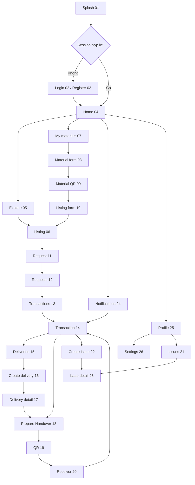

# STUDYSHARE — BỘ ĐẶC TẢ UI/UX MVP & HƯỚNG DẪN TRIỂN KHAI
**Mã:** SS-UIUX-01 · **Phiên bản:** 1.1 – đồng bộ SS-BR v2.0 và README giảng viên · **Ngày:** 21/11/2026
**Dự án:** StudyShare – Ứng dụng di động hỗ trợ cho mượn, chuyển nhượng tài liệu học tập và xác thực giao nhận giữa sinh viên
**Nhóm:** 12 – 65KTPM · **Nhóm trưởng:** Nguyễn Văn Trường · **Nền tảng:** Android Flutter/Dart
> **Phạm vi trạng thái:** SCR-04 đến SCR-26 và Bottom Navigation đã được nhóm trưởng duyệt trong hội thoại. SCR-01 đến SCR-03 được hoàn thiện trong bản tài liệu này theo yêu cầu mới. Đây là đặc tả thiết kế, **chưa phải code/SQL/Contracts đã triển khai**, và không xác nhận trạng thái merge GitHub.
> **Nguồn đối chiếu:** `QUY_TAC_NGHIEP_VU.md` (SS-BR v2.0 trên nhánh integration), `QUY_TRINH_HOAT_DONG.md` (UI-01…UI-18), `QUY_TRINH_GIT_NHOM.md`; những quyết định đã chốt tiếp theo trong hội thoại được ưu tiên ghi rõ, nhưng phải cập nhật SS-BR/Contracts trước khi lập trình nếu tài liệu kho còn lệch.

## 1. Tóm tắt quyết định đã chốt
- **26 đích điều hướng SCR-01…SCR-26**, tương ứng 18 mã UI nghiệp vụ cũ (không tự nhân bản hệ thống UI).
- **5 mục Bottom Navigation:** Trang chủ, Khám phá, Đăng tin, Giao dịch, Cá nhân. Đăng tin mở luồng chọn/tạo Material rồi Listing, không đăng tự động.
- **Logo phải giữ nguyên hình gốc được người dùng duyệt:** bản nền trắng và bản nền xanh; không vẽ lại hoặc thay đổi bố cục. Minh họa trong DOCX chèn lại hình ảnh gốc được cung cấp, không phác nét logo.
- **Màu:** `#17411B` xanh đậm, `#0FA241` xanh chính, `#ECF665` vàng chanh; dùng semantic token cho Dark/Light, cảnh báo/lỗi và 4 bảng màu tùy chọn.
- **Lưới giấy vở:** xanh/vàng nhạt, nhấn ở nền nội dung hoặc banner, có thể tắt. **Lá rơi nhẹ:** chỉ Splash/Home/empty state, có thể tắt, tự tắt với Reduced Motion; tuyệt đối không phủ QR/camera/ảnh/biểu mẫu giao nhận/Issue.
- **Ngôn ngữ:** Việt mặc định, English tùy chọn; **thông báo in-app** bắt buộc, push khi app đóng để sau MVP.
- **Quy tắc thao tác:** dialog khi nghiệp vụ có hậu quả; snackbar 3 giây thành công/4 giây lỗi; server ACK mới hiển thị trạng thái thành công; offline chỉ giữ nháp/cache không xác nhận giả.

## 2. SCR-01 đến SCR-03 – đặc tả hoàn chỉnh
### SCR-01 – Splash / Khởi động
**Mục đích.** Xác minh phiên người dùng và khởi tạo cấu hình theme/locale trước khi mở nội dung riêng tư.
**Bố cục.** Full screen `#17411B`; sử dụng **nguyên ảnh logo nền xanh** đã duyệt, căn giữa an toàn; phía dưới có spinner nhỏ và thông điệp “Đang khởi động StudyShare…”. Có thể thêm lưới mảnh và một số lá chuyển động nhẹ trong vùng trống, không thay thế logo. Không cần nút CTA khi khởi tạo bình thường.
**Luồng trạng thái.** `booting → checkingSession → authenticated → /home`; hoặc `unauthenticated → /login`; khi mạng lỗi chỉ chặn nếu thao tác bắt buộc xác thực, hiện “Thử lại” và “Đăng nhập”; trường hợp lỗi cấu hình phải hiển thị thông báo dễ hiểu. Đặt timeout hữu ích để tránh đứng vô hạn; không giả phiên hợp lệ.
**Điều kiện.** Không yêu cầu GPS/camera ở Splash; không ép hiển thị onboarding mỗi lần mở; khi logout xóa route riêng tư khỏi stack. Theme/locale load từ lựa chọn lưu trong thiết bị trước khi vẽ để tránh nháy sáng/tối.
**Kiểm thử.** Đã login; chưa login; session hết hạn; offline có/không session còn hợp lệ; deep link sau đăng nhập; dark mode; giảm chuyển động.

### SCR-02 – Đăng nhập
**Bố cục.** Nền trắng/surface sáng, trên cùng dùng **nguyên ảnh logo nền trắng**; tiêu đề “Chào mừng trở lại”; input `Email`, `Mật khẩu` (ẩn mặc định + hiện/ẩn), CTA “Đăng nhập”, link “Quên mật khẩu?”, divider nhẹ và CTA phụ “Tạo tài khoản”. Tránh lưới/hiệu ứng lá sau vùng form.
**Validation.** Bỏ khoảng trắng hai đầu email, định dạng email hợp lệ; mật khẩu không rỗng; thông báo sai email/mật khẩu an toàn (không tiết lộ tài khoản có tồn tại). Loading sau submit, disable bấm lặp, giữ email khi lỗi. Dùng `AutofillHints` và loại bàn phím email; nhấn submit từ keyboard.
**Quên mật khẩu.** Bottom sheet/trang phụ trong feature Auth: nhập email → Supabase reset-password email → thông báo trung lập → mở deep link xác thực và cập nhật mật khẩu với kiểm tra session. Đây không tăng số SCR chính. Không tạo mật khẩu tạm phía Flutter.
**Điều hướng.** Login OK → trang đích ban đầu nếu vẫn có quyền, nếu không → SCR-04; Signup → SCR-03. Nếu session hết hạn ở route riêng tư, chuyển Login và lưu ý định route phù hợp, không lưu ảnh/bằng chứng trong query string.
**Auth provider.** Email/password dùng cho MVP; Google là tùy chọn nếu provider và Android redirect đã được cấu hình. Không giả định có nút Google sẵn khi chưa thiết lập.

### SCR-03 – Đăng ký
**Bố cục.** AppBar có back; tiêu đề “Tạo tài khoản”; 4 trường `Tên hiển thị`, `Email`, `Mật khẩu`, `Xác nhận mật khẩu`; link điều khoản/quyền riêng tư nếu đã có; CTA “Tạo tài khoản”; CTA phụ “Đã có tài khoản? Đăng nhập”. Logo nền trắng cỡ nhỏ ở đầu form.
**Validation.** Tên không trống; email đúng định dạng; mật khẩu theo chính sách cấu hình Auth; xác nhận mật khẩu khớp; không hiển thị mật khẩu ra log, không lưu plaintext vào local. Báo lỗi từng trường. Mã sinh viên, email trường hoặc upload giấy tờ không được thêm như yêu cầu bắt buộc khi chưa có quy tắc đã chốt.
**Kết quả.** Tạo tài khoản ACK → trang “Kiểm tra email” khi Supabase đang yêu cầu xác minh, có nút gửi lại có giới hạn; nếu xác minh đã tắt trong cấu hình, điều hướng theo session hợp lệ. Không đánh dấu tài khoản đã xác minh trước khi server xác thực. Khi email tồn tại hoặc có lỗi rate limit, trả thông báo an toàn.
**Kiểm thử.** Email trùng, mạng mất giữa submit, sai confirm, verify link hết hạn, back, keyboard che CTA, vi/en, dark mode.

## 3. Danh mục 26 màn hình và hợp đồng UX
Các hình mockup minh họa trong DOCX và gói assets **không phải thiết kế pixel-perfect đã code**. Mỗi màn đều cần loading/empty/error/offline, xác nhận khi hành động nguy hiểm, state từ server và truy cập theo quyền.

| SCR | Tên màn hình | UI nghiệp vụ | Phụ trách chính | Mục tiêu |
|---|---|---|---|---|
| SCR-01 | Splash / Khởi động | UI-01 (khởi động trước xác thực) | Trường | Kiểm tra phiên; điều hướng đúng |
| SCR-02 | Đăng nhập | UI-01 | Trường | Tạo phiên đăng nhập hợp lệ |
| SCR-03 | Đăng ký | UI-01 | Trường | Tạo tài khoản sinh viên |
| SCR-04 | Trang chủ | UI-02 | Trường | Nắm việc cần làm và truy cập nhanh |
| SCR-05 | Khám phá | UI-03 | Khanh | Tìm Listing còn công khai |
| SCR-06 | Chi tiết Listing | UI-04 | Khanh + Trường | Đọc thông tin trước khi yêu cầu |
| SCR-07 | Tài liệu của tôi | UI-06 | Trường | Quản lý các Material thuộc sở hữu |
| SCR-08 | Thêm / sửa Material | UI-05 | Trường | Tạo hoặc chỉnh sửa bản sách vật lý |
| SCR-09 | Chi tiết Material / QR | UI-06 | Trường | Xem định danh và điều kiện đăng |
| SCR-10 | Tạo / sửa Listing | UI-05 | Trường | Công khai một offer từ Material |
| SCR-11 | Gửi yêu cầu | UI-07 | Khanh | Tạo ExchangeRequest PENDING |
| SCR-12 | Trung tâm yêu cầu | UI-08 | Khanh | Theo dõi và phê duyệt Request |
| SCR-13 | Giao dịch của tôi | UI-16 + UI-09 (danh sách) | Sơn | Theo dõi Transaction theo vai trò |
| SCR-14 | Chi tiết Transaction | UI-09 + UI-15 + UI-10 (điều hướng) | Sơn + Khanh | Theo dõi tiến trình và hành động hợp lệ |
| SCR-15 | Danh sách giao hộ | UI-11 | Đăng | Khám phá/điều phối nhiệm vụ C |
| SCR-16 | Tạo nhiệm vụ giao hộ | UI-10 + UI-12 | Đăng | Lập nhiệm vụ liên kết chặng hợp lệ |
| SCR-17 | Chi tiết nhiệm vụ giao hộ | UI-12 | Đăng | Ứng tuyển/chọn C/theo dõi từng chặng |
| SCR-18 | Chuẩn bị Handover | UI-13 | Đăng | Thu ảnh và xác minh chặng từ người giao |
| SCR-19 | Quét QR | UI-13 | Đăng | Đối chiếu đúng Material |
| SCR-20 | Xác nhận nhận tài liệu | UI-14 | Đăng | Người nhận xác nhận lượt giao |
| SCR-21 | Danh sách Issue | UI-09/UI-16 (màn con) | Sơn | Tìm sự cố được phép xem |
| SCR-22 | Tạo Issue | UI-09/UI-14 (màn con) | Sơn + Đăng | Ghi nhận sự cố kèm bằng chứng |
| SCR-23 | Chi tiết Issue | UI-09/UI-16 (màn con) | Sơn | Trao đổi và thống nhất hướng giải quyết |
| SCR-24 | Thông báo | UI-17 | Sơn | Đi thẳng đến hành động cần xử lý |
| SCR-25 | Cá nhân | UI-18 | Trường | Xem hồ sơ và lối tắt của tôi |
| SCR-26 | Cài đặt | UI-18 | Trường | Tùy chỉnh giao diện và tài khoản |

### Đặc tả theo từng màn hình
#### SCR-01 – Splash / Khởi động
- **Mục tiêu:** Kiểm tra phiên; điều hướng đúng. **Chủ trì:** Trường. **Ánh xạ:** UI-01 (khởi động trước xác thực).
- **Cấu trúc/fields:** Logo chuẩn nền xanh; trạng thái khởi tạo; lỗi mạng có thử lại.
- **CTA & điều hướng:** Đã xác thực → SCR-04; chưa xác thực → SCR-02.
- **Điều kiện/chặn quan trọng:** Không truy cập dữ liệu riêng tư khi session không hợp lệ; không ép onboarding.
- **Trạng thái UI:** loading skeleton/indicator, empty state có hướng dẫn, lỗi có retry, offline có nhãn rõ; không đánh dấu thành công trước server ACK. Button disabled khi chưa đủ điều kiện hoặc request pending.

#### SCR-02 – Đăng nhập
- **Mục tiêu:** Tạo phiên đăng nhập hợp lệ. **Chủ trì:** Trường. **Ánh xạ:** UI-01.
- **Cấu trúc/fields:** Logo nền trắng; email; mật khẩu; xem/ẩn; đăng nhập; quên mật khẩu; đăng ký.
- **CTA & điều hướng:** Đăng nhập OK → SCR-04 hoặc trang đích trước đó; đăng ký → SCR-03.
- **Điều kiện/chặn quan trọng:** Validation tại trường; loading; chống bấm lặp; reset password phụ thuộc email link.
- **Trạng thái UI:** loading skeleton/indicator, empty state có hướng dẫn, lỗi có retry, offline có nhãn rõ; không đánh dấu thành công trước server ACK. Button disabled khi chưa đủ điều kiện hoặc request pending.

#### SCR-03 – Đăng ký
- **Mục tiêu:** Tạo tài khoản sinh viên. **Chủ trì:** Trường. **Ánh xạ:** UI-01.
- **Cấu trúc/fields:** Tên hiển thị; email; mật khẩu; nhập lại mật khẩu; điều khoản phù hợp.
- **CTA & điều hướng:** Tạo thành công → xác minh email nếu cấu hình; sau xác thực → SCR-04.
- **Điều kiện/chặn quan trọng:** Không tự bắt buộc mã sinh viên; email verification phụ thuộc cấu hình Supabase.
- **Trạng thái UI:** loading skeleton/indicator, empty state có hướng dẫn, lỗi có retry, offline có nhãn rõ; không đánh dấu thành công trước server ACK. Button disabled khi chưa đủ điều kiện hoặc request pending.

#### SCR-04 – Trang chủ
- **Mục tiêu:** Nắm việc cần làm và truy cập nhanh. **Chủ trì:** Trường. **Ánh xạ:** UI-02.
- **Cấu trúc/fields:** Chuông; tìm kiếm; việc cần xử lý; tổng quan; thao tác nhanh; tài liệu mới.
- **CTA & điều hướng:** Chuông → SCR-24; tìm → SCR-05; hành động mở đúng ngữ cảnh.
- **Điều kiện/chặn quan trọng:** Việc cần xử lý dựa server; dữ liệu minh họa không hiện như số liệu thật.
- **Trạng thái UI:** loading skeleton/indicator, empty state có hướng dẫn, lỗi có retry, offline có nhãn rõ; không đánh dấu thành công trước server ACK. Button disabled khi chưa đủ điều kiện hoặc request pending.

#### SCR-05 – Khám phá
- **Mục tiêu:** Tìm Listing còn công khai. **Chủ trì:** Khanh. **Ánh xạ:** UI-03.
- **Cấu trúc/fields:** Search; lọc BORROW/SELL/DONATE; filter sheet; thẻ tài liệu; sắp xếp.
- **CTA & điều hướng:** Chọn card → SCR-06; xem tất cả từ Home → SCR-05.
- **Điều kiện/chặn quan trọng:** PUBLISHED+RESERVED vẫn hiện “Đã được đặt”; ARCHIVED ẩn.
- **Trạng thái UI:** loading skeleton/indicator, empty state có hướng dẫn, lỗi có retry, offline có nhãn rõ; không đánh dấu thành công trước server ACK. Button disabled khi chưa đủ điều kiện hoặc request pending.

#### SCR-06 – Chi tiết Listing
- **Mục tiêu:** Đọc thông tin trước khi yêu cầu. **Chủ trì:** Khanh + Trường. **Ánh xạ:** UI-04.
- **Cấu trúc/fields:** Gallery; tên; offer; giá/nội dung; tình trạng; người đăng; CTA.
- **CTA & điều hướng:** CTA → SCR-11; chính chủ → quản lý bài.
- **Điều kiện/chặn quan trọng:** Không công khai QR Material; ẩn dữ liệu cá nhân; RESERVED vô hiệu CTA.
- **Trạng thái UI:** loading skeleton/indicator, empty state có hướng dẫn, lỗi có retry, offline có nhãn rõ; không đánh dấu thành công trước server ACK. Button disabled khi chưa đủ điều kiện hoặc request pending.

#### SCR-07 – Tài liệu của tôi
- **Mục tiêu:** Quản lý các Material thuộc sở hữu. **Chủ trì:** Trường. **Ánh xạ:** UI-06.
- **Cấu trúc/fields:** Tìm kiếm; filter; card; thêm tài liệu; trạng thái.
- **CTA & điều hướng:** Thêm → SCR-08; chạm card → SCR-09.
- **Điều kiện/chặn quan trọng:** Owner khác holder; sách đã bán/tặng không còn trong sở hữu A.
- **Trạng thái UI:** loading skeleton/indicator, empty state có hướng dẫn, lỗi có retry, offline có nhãn rõ; không đánh dấu thành công trước server ACK. Button disabled khi chưa đủ điều kiện hoặc request pending.

#### SCR-08 – Thêm / sửa Material
- **Mục tiêu:** Tạo hoặc chỉnh sửa bản sách vật lý. **Chủ trì:** Trường. **Ánh xạ:** UI-05.
- **Cấu trúc/fields:** Tên; môn/loại; tình trạng; mô tả; ảnh; lưu nháp.
- **CTA & điều hướng:** Lưu ACK → SCR-09; hủy giữ xác nhận nếu đã sửa.
- **Điều kiện/chặn quan trọng:** Offline chỉ lưu nháp; không tạo QR/Material giả; không sửa lịch sử.
- **Trạng thái UI:** loading skeleton/indicator, empty state có hướng dẫn, lỗi có retry, offline có nhãn rõ; không đánh dấu thành công trước server ACK. Button disabled khi chưa đủ điều kiện hoặc request pending.

#### SCR-09 – Chi tiết Material / QR
- **Mục tiêu:** Xem định danh và điều kiện đăng. **Chủ trì:** Trường. **Ánh xạ:** UI-06.
- **Cấu trúc/fields:** Mã vật lý; owner; holder; QR; lịch sử; nút tạo Listing.
- **CTA & điều hướng:** Đủ điều kiện → SCR-10; xem lịch sử → SCR-13.
- **Điều kiện/chặn quan trọng:** Một Material giữ nguyên QR khi tái đăng; QR không phải ACK nhận sách.
- **Trạng thái UI:** loading skeleton/indicator, empty state có hướng dẫn, lỗi có retry, offline có nhãn rõ; không đánh dấu thành công trước server ACK. Button disabled khi chưa đủ điều kiện hoặc request pending.

#### SCR-10 – Tạo / sửa Listing
- **Mục tiêu:** Công khai một offer từ Material. **Chủ trì:** Trường. **Ánh xạ:** UI-05.
- **Cấu trúc/fields:** Chọn 1 trong BORROW/SELL/DONATE; mô tả; giá khi SELL; khu vực hẹn.
- **CTA & điều hướng:** Đăng ACK → SCR-06; lưu nháp nếu chọn.
- **Điều kiện/chặn quan trọng:** Một Listing một offer; SELL giá >0; không đăng đồng thời 2 Listing.
- **Trạng thái UI:** loading skeleton/indicator, empty state có hướng dẫn, lỗi có retry, offline có nhãn rõ; không đánh dấu thành công trước server ACK. Button disabled khi chưa đủ điều kiện hoặc request pending.

#### SCR-11 – Gửi yêu cầu
- **Mục tiêu:** Tạo ExchangeRequest PENDING. **Chủ trì:** Khanh. **Ánh xạ:** UI-07.
- **Cấu trúc/fields:** Tóm tắt Listing; số ngày BORROW 1–30; lời nhắn; confirm.
- **CTA & điều hướng:** Gửi ACK → SCR-12.
- **Điều kiện/chặn quan trọng:** Chủ không tự yêu cầu; RESERVED/ARCHIVED chặn; SELL chưa chuyển tiền.
- **Trạng thái UI:** loading skeleton/indicator, empty state có hướng dẫn, lỗi có retry, offline có nhãn rõ; không đánh dấu thành công trước server ACK. Button disabled khi chưa đủ điều kiện hoặc request pending.

#### SCR-12 – Trung tâm yêu cầu
- **Mục tiêu:** Theo dõi và phê duyệt Request. **Chủ trì:** Khanh. **Ánh xạ:** UI-08.
- **Cấu trúc/fields:** Tab đã gửi/đã nhận; lọc; card; duyệt/từ chối/rút khi hợp lệ.
- **CTA & điều hướng:** Duyệt ACK → SCR-14; chờ → chi tiết Request trong SCR-12.
- **Điều kiện/chặn quan trọng:** Chỉ một Request ACCEPTED; việc từ chối cạnh tranh là nguyên tử server.
- **Trạng thái UI:** loading skeleton/indicator, empty state có hướng dẫn, lỗi có retry, offline có nhãn rõ; không đánh dấu thành công trước server ACK. Button disabled khi chưa đủ điều kiện hoặc request pending.

#### SCR-13 – Giao dịch của tôi
- **Mục tiêu:** Theo dõi Transaction theo vai trò. **Chủ trì:** Sơn. **Ánh xạ:** UI-16 + UI-09 (danh sách).
- **Cấu trúc/fields:** Tab đang xử lý/hoàn tất/có Issue; card; hạn trả; bộ lọc.
- **CTA & điều hướng:** Card → SCR-14; nhánh giao hộ → SCR-15.
- **Điều kiện/chặn quan trọng:** OVERDUE là nhãn suy ra; Issue đang mở không tự đổi status Transaction.
- **Trạng thái UI:** loading skeleton/indicator, empty state có hướng dẫn, lỗi có retry, offline có nhãn rõ; không đánh dấu thành công trước server ACK. Button disabled khi chưa đủ điều kiện hoặc request pending.

#### SCR-14 – Chi tiết Transaction
- **Mục tiêu:** Theo dõi tiến trình và hành động hợp lệ. **Chủ trì:** Sơn + Khanh. **Ánh xạ:** UI-09 + UI-15 + UI-10 (điều hướng).
- **Cấu trúc/fields:** Thông tin; timeline; hạn BORROW; xác nhận tiền SELL; mở giao nhận/Issue.
- **CTA & điều hướng:** Tạo delivery → SCR-16; handover → SCR-18; Issue → SCR-22.
- **Điều kiện/chặn quan trọng:** SELL A xác nhận tiền trước mọi Handover; due từ B nhận ACK; hủy có đồng thuận.
- **Trạng thái UI:** loading skeleton/indicator, empty state có hướng dẫn, lỗi có retry, offline có nhãn rõ; không đánh dấu thành công trước server ACK. Button disabled khi chưa đủ điều kiện hoặc request pending.

#### SCR-15 – Danh sách giao hộ
- **Mục tiêu:** Khám phá/điều phối nhiệm vụ C. **Chủ trì:** Đăng. **Ánh xạ:** UI-11.
- **Cấu trúc/fields:** Tab có thể nhận/đã ứng tuyển/đang giao/lịch sử; task card.
- **CTA & điều hướng:** Task → SCR-17; tạo từ SCR-14 → SCR-16.
- **Điều kiện/chặn quan trọng:** Không lộ địa điểm chi tiết trước khi C được chọn.
- **Trạng thái UI:** loading skeleton/indicator, empty state có hướng dẫn, lỗi có retry, offline có nhãn rõ; không đánh dấu thành công trước server ACK. Button disabled khi chưa đủ điều kiện hoặc request pending.

#### SCR-16 – Tạo nhiệm vụ giao hộ
- **Mục tiêu:** Lập nhiệm vụ liên kết chặng hợp lệ. **Chủ trì:** Đăng. **Ánh xạ:** UI-10 + UI-12.
- **Cấu trúc/fields:** Transaction cố định; người giao/nhận; điểm lấy/giao; ghi chú; GPS tùy chọn.
- **CTA & điều hướng:** Tạo ACK → SCR-17.
- **Điều kiện/chặn quan trọng:** B được tạo chiều trả; tạo task không đổi holder; không GPS liên tục.
- **Trạng thái UI:** loading skeleton/indicator, empty state có hướng dẫn, lỗi có retry, offline có nhãn rõ; không đánh dấu thành công trước server ACK. Button disabled khi chưa đủ điều kiện hoặc request pending.

#### SCR-17 – Chi tiết nhiệm vụ giao hộ
- **Mục tiêu:** Ứng tuyển/chọn C/theo dõi từng chặng. **Chủ trì:** Đăng. **Ánh xạ:** UI-12.
- **Cấu trúc/fields:** Ứng viên; chọn 1 C; trạng thái chặng; chỉ đường; lỗi; đánh giá.
- **CTA & điều hướng:** Handover → SCR-18; thất bại → chặng hoàn đúng người.
- **Điều kiện/chặn quan trọng:** C→người đã giao sách cho C; 3 ngày tái bàn giao ở chiều trả.
- **Trạng thái UI:** loading skeleton/indicator, empty state có hướng dẫn, lỗi có retry, offline có nhãn rõ; không đánh dấu thành công trước server ACK. Button disabled khi chưa đủ điều kiện hoặc request pending.

#### SCR-18 – Chuẩn bị Handover
- **Mục tiêu:** Thu ảnh và xác minh chặng từ người giao. **Chủ trì:** Đăng. **Ánh xạ:** UI-13.
- **Cấu trúc/fields:** Thông tin from/to; ≥1 ảnh người giao; chuẩn bị QR; tiến độ upload.
- **CTA & điều hướng:** Ảnh ACK → SCR-19 hoặc chờ SCR-20 tùy vai trò.
- **Điều kiện/chặn quan trọng:** Ảnh thuộc đúng Handover; chưa ACK không chuyển holder.
- **Trạng thái UI:** loading skeleton/indicator, empty state có hướng dẫn, lỗi có retry, offline có nhãn rõ; không đánh dấu thành công trước server ACK. Button disabled khi chưa đủ điều kiện hoặc request pending.

#### SCR-19 – Quét QR
- **Mục tiêu:** Đối chiếu đúng Material. **Chủ trì:** Đăng. **Ánh xạ:** UI-13.
- **Cấu trúc/fields:** Camera preview; flashlight; khung scan; trạng thái đúng/sai; fallback.
- **CTA & điều hướng:** Đúng → tiếp tục; sai → chặn; thiếu/không đọc → lý do fallback.
- **Điều kiện/chặn quan trọng:** QR đọc được nhưng mismatch tuyệt đối không bypass thủ công.
- **Trạng thái UI:** loading skeleton/indicator, empty state có hướng dẫn, lỗi có retry, offline có nhãn rõ; không đánh dấu thành công trước server ACK. Button disabled khi chưa đủ điều kiện hoặc request pending.

#### SCR-20 – Xác nhận nhận tài liệu
- **Mục tiêu:** Người nhận xác nhận lượt giao. **Chủ trì:** Đăng. **Ánh xạ:** UI-14.
- **Cấu trúc/fields:** Material; người giao; ảnh; QR status; xác nhận hoặc từ chối.
- **CTA & điều hướng:** Xác nhận ACK → SCR-14/17; từ chối → SCR-22.
- **Điều kiện/chặn quan trọng:** Receiver đúng định danh, server ACK rồi mới đổi holder.
- **Trạng thái UI:** loading skeleton/indicator, empty state có hướng dẫn, lỗi có retry, offline có nhãn rõ; không đánh dấu thành công trước server ACK. Button disabled khi chưa đủ điều kiện hoặc request pending.

#### SCR-21 – Danh sách Issue
- **Mục tiêu:** Tìm sự cố được phép xem. **Chủ trì:** Sơn. **Ánh xạ:** UI-09/UI-16 (màn con).
- **Cấu trúc/fields:** Tab đang mở/đã giải quyết; issue card; dấu cần phản hồi.
- **CTA & điều hướng:** Card → SCR-23; tạo Issue từ ngữ cảnh giao dịch.
- **Điều kiện/chặn quan trọng:** Issue không được làm trạng thái Transaction thay đổi tùy ý.
- **Trạng thái UI:** loading skeleton/indicator, empty state có hướng dẫn, lỗi có retry, offline có nhãn rõ; không đánh dấu thành công trước server ACK. Button disabled khi chưa đủ điều kiện hoặc request pending.

#### SCR-22 – Tạo Issue
- **Mục tiêu:** Ghi nhận sự cố kèm bằng chứng. **Chủ trì:** Sơn + Đăng. **Ánh xạ:** UI-09/UI-14 (màn con).
- **Cấu trúc/fields:** Transaction/Handover cố định; loại; mô tả; ảnh tùy; quyền riêng tư.
- **CTA & điều hướng:** Gửi ACK → SCR-23.
- **Điều kiện/chặn quan trọng:** Không chuyển holder/owner; bằng chứng private; quyền theo vai trò.
- **Trạng thái UI:** loading skeleton/indicator, empty state có hướng dẫn, lỗi có retry, offline có nhãn rõ; không đánh dấu thành công trước server ACK. Button disabled khi chưa đủ điều kiện hoặc request pending.

#### SCR-23 – Chi tiết Issue
- **Mục tiêu:** Trao đổi và thống nhất hướng giải quyết. **Chủ trì:** Sơn. **Ánh xạ:** UI-09/UI-16 (màn con).
- **Cấu trúc/fields:** Nội dung; timeline; evidence theo quyền; đề xuất; các xác nhận.
- **CTA & điều hướng:** Phản hồi → refresh; đủ ACK → resolved.
- **Điều kiện/chặn quan trọng:** Không ai tự đóng thay; admin chỉ điều phối trong phạm vi được phép.
- **Trạng thái UI:** loading skeleton/indicator, empty state có hướng dẫn, lỗi có retry, offline có nhãn rõ; không đánh dấu thành công trước server ACK. Button disabled khi chưa đủ điều kiện hoặc request pending.

#### SCR-24 – Thông báo
- **Mục tiêu:** Đi thẳng đến hành động cần xử lý. **Chủ trì:** Sơn. **Ánh xạ:** UI-17.
- **Cấu trúc/fields:** Chưa đọc/đã đọc; card; đánh dấu đã đọc; deep-link nội bộ.
- **CTA & điều hướng:** Tap → SCR-12/14/17/20/23 theo loại.
- **Điều kiện/chặn quan trọng:** Tải lại quyền trước khi mở; không lộ evidence riêng tư trong preview.
- **Trạng thái UI:** loading skeleton/indicator, empty state có hướng dẫn, lỗi có retry, offline có nhãn rõ; không đánh dấu thành công trước server ACK. Button disabled khi chưa đủ điều kiện hoặc request pending.

#### SCR-25 – Cá nhân
- **Mục tiêu:** Xem hồ sơ và lối tắt của tôi. **Chủ trì:** Trường. **Ánh xạ:** UI-18.
- **Cấu trúc/fields:** Avatar; tên; mã thành viên; thống kê; tài liệu; lịch sử; cài đặt.
- **CTA & điều hướng:** SCR-07/13/15/21/26.
- **Điều kiện/chặn quan trọng:** Không lộ email/địa chỉ/GPS chi tiết khi xem công khai.
- **Trạng thái UI:** loading skeleton/indicator, empty state có hướng dẫn, lỗi có retry, offline có nhãn rõ; không đánh dấu thành công trước server ACK. Button disabled khi chưa đủ điều kiện hoặc request pending.

#### SCR-26 – Cài đặt
- **Mục tiêu:** Tùy chỉnh giao diện và tài khoản. **Chủ trì:** Trường. **Ánh xạ:** UI-18.
- **Cấu trúc/fields:** Theme xanh/xanh dương/tím/cam; sáng/tối/hệ thống; lưới; lá; vi/en; logout.
- **CTA & điều hướng:** Áp dụng tức thì; logout → SCR-02 sau confirm.
- **Điều kiện/chặn quan trọng:** Logo không đổi màu/hình; tắt lá khi reduce motion; không phủ camera.
- **Trạng thái UI:** loading skeleton/indicator, empty state có hướng dẫn, lỗi có retry, offline có nhãn rõ; không đánh dấu thành công trước server ACK. Button disabled khi chưa đủ điều kiện hoặc request pending.

## 4. Đối chiếu mã UI gốc (18) với SCR (26)
Đây là ánh xạ để không sửa cách đánh số UI nghiệp vụ đã được tài liệu SS-WF sử dụng; màn SCR có thể là màn con hoặc section của UI gốc.
| UI gốc | Tên trong SS-WF | SCR hiển thị/điều hướng |
|---|---|---|
| UI-01 | Đăng nhập/đăng ký | SCR-01, SCR-02, SCR-03 |
| UI-02 | Trang chủ | SCR-04 |
| UI-03 | Khám phá/tìm kiếm | SCR-05 |
| UI-04 | Chi tiết tài liệu/Listing | SCR-06 |
| UI-05 | Đăng/sửa tài liệu và Listing | SCR-08, SCR-10 |
| UI-06 | Tài liệu của tôi / QR | SCR-07, SCR-09 |
| UI-07 | Gửi Request | SCR-11 |
| UI-08 | Yêu cầu đã gửi/nhận | SCR-12 |
| UI-09 | Transaction/timeline; Issue con | SCR-13, SCR-14, SCR-21–23 |
| UI-10 | Giao trực tiếp/giao hộ, điểm hẹn | SCR-14, SCR-16, SCR-18 |
| UI-11 | Danh sách giao hộ | SCR-15 |
| UI-12 | Chi tiết giao hộ/GPS | SCR-16, SCR-17 |
| UI-13 | QR/ảnh minh chứng | SCR-18, SCR-19 |
| UI-14 | Receiver xác nhận | SCR-20 |
| UI-15 | Mượn/trả/hạn trả | SCR-11, SCR-14 |
| UI-16 | Hoạt động và lịch sử | SCR-13, SCR-14, SCR-21, SCR-23, SCR-25 |
| UI-17 | Thông báo | SCR-24 |
| UI-18 | Cá nhân và cài đặt | SCR-25, SCR-26 |

## 5. Sơ đồ điều hướng thống nhất
**Shell 5 tab**: `/home` → SCR-04; `/explore` → SCR-05; `Đăng tin` → chọn Material SCR-07/08 rồi SCR-10; `/transactions` → SCR-13; `/profile` → SCR-25. Các route chi tiết push bên trong Shell hoặc overlay toàn màn có back chuẩn; camera/ảnh/xác nhận Handover có thể ẩn Bottom Navigation.



**Deep link:** thông báo chỉ giữ `entity_type` + ID opaque nội bộ; resolver kiểm tra session, RLS/quyền, trạng thái mới rồi mở SCR-12/14/17/20/23. Khi không còn truy cập: thông báo “Nội dung không còn khả dụng” và về màn an toàn.
**Back stack:** Tab → root tab; Detail → parent; form có thay đổi chưa lưu phải confirm rời trang; logout reset stack về auth. Back trong scanner trả màn Handover không tự thay nghiệp vụ.

### Route đề xuất (`go_router`, chưa khóa tên thực tế)
| Nhóm | Path | Màn | Ghi chú |
|---|---|---|---|
| Ứng dụng | /splash | SCR-01 | Khởi tạo + auth guard |
| Xác thực | /login | SCR-02 | Đăng nhập |
| Xác thực | /register | SCR-03 | Đăng ký |
| Tab Trang chủ | /home | SCR-04 | Tab 1 |
| Tab Khám phá | /explore | SCR-05 | Tab 2 |
| Bài đăng | /listings/:id | SCR-06 | Details |
| Tài liệu | /my-materials | SCR-07 | Danh sách |
| Tài liệu | /materials/new; /materials/:id/edit | SCR-08 | Form |
| Tài liệu | /materials/:id | SCR-09 | Detail |
| Tab Đăng tin | /listings/new?material=:id | SCR-10 | Tab 3 mở flow chọn Material |
| Yêu cầu | /listings/:id/request | SCR-11 | Form |
| Yêu cầu | /requests | SCR-12 | Sent/Incoming |
| Tab Giao dịch | /transactions | SCR-13 | Tab 4 |
| Giao dịch | /transactions/:id | SCR-14 | Timeline |
| Giao hộ | /deliveries | SCR-15 | Danh sách |
| Giao hộ | /transactions/:id/deliveries/new | SCR-16 | Form |
| Giao hộ | /deliveries/:id | SCR-17 | Task |
| Handover | /handovers/:id/prepare | SCR-18 | Giver |
| Handover | /handovers/:id/scan | SCR-19 | Scanner |
| Handover | /handovers/:id/receive | SCR-20 | Receiver |
| Issue | /issues | SCR-21 | Danh sách |
| Issue | /transactions/:id/issues/new | SCR-22 | Context |
| Issue | /issues/:id | SCR-23 | Detail |
| Thông báo | /notifications | SCR-24 | Bell |
| Tab Cá nhân | /profile | SCR-25 | Tab 5 |
| Cài đặt | /settings | SCR-26 | Theme, language |

## 6. Design System – tokens và quy tắc hiển thị
### Màu và typography
| Token | Light | Dark dự kiến | Sử dụng |
|---|---|---|---|
| brand.dark | #17411B | #DDEEDC | Heading, backdrop, brand |
| brand.primary | #0FA241 | #57CF81 | Primary, link hành động |
| brand.lime | #ECF665 | #DDEC57 | Accent dùng rất ít |
| surface.canvas | #F8FCF7 | #101A14 | Nền ứng dụng |
| surface.card | #FFFFFF | #1C2A20 | Card |
| text.primary | #17411B | #F2F8F1 | Văn bản chính |
| text.muted | #64748B | #B3C4B8 | Văn bản phụ |
| status.success | #16A34A | #67D08C | Success |
| status.warning | #F59E0B | #F6B951 | Warning |
| status.error | #DC2626 | #FF7373 | Error |
| status.info | #2563EB | #78A8FC | Info |

**Font:** Inter (phải xác nhận font asset được cấp phép trong repository trước khi phân phối); fallback hệ thống hỗ trợ tiếng Việt. Body 14–16sp; heading 20–24sp; caption 12sp; text scale hệ thống phải được tôn trọng. 48dp cho vùng chạm; 16dp padding ngoài; spacing 4/8/12/16/24; radius card 16, button 12; app bar ~56dp; bottom nav ~72–80dp + safe area. Chuyển động vi mô 150–250ms, không ép animation khi Reduced Motion.
**Tương phản:** kiểm tra WCAG theo cặp màu thật. Không mặc định chữ trắng trên `#0FA241` hoặc `#ECF665` cho văn bản nhỏ khi chưa đo; token `onPrimary` có thể là xanh rất đậm hoặc dùng biến thể màu nút tối hơn. Không dùng màu làm tín hiệu duy nhất.
### Logo – tài sản bất biến
- `logo_light_original.png`: nguyên hình người dùng cung cấp, nền trắng. Dùng ở Login/Register và các trang sáng thích hợp.
- `logo_dark_original.png`: nguyên hình phiên bản nền xanh có trong ngữ cảnh thiết kế, dùng Splash/banner tối. Hai phiên bản không được dùng color filter để đổi màu hoặc vẽ lại.
- Khi cần app icon/avatar nhỏ, **crop giữ nguyên tỷ lệ từ tài sản chính thức** hoặc yêu cầu asset chuẩn riêng; không tự tái tạo logo bằng icon Flutter. Logo có nền phải dùng trên nền hợp lệ, không xóa nền kiểu tự động rồi coi là asset chính thức.
### Nền lưới ô vuông và lá rơi
- Lưới 20–28dp, nét 0.5–1dp, xanh/vàng rất nhạt; chỉ vẽ dưới surface/card, không phủ lên chữ hoặc ảnh chứng cứ. Light và Dark có bộ alpha riêng. Bật/tắt trong SCR-26.
- Lá rơi 2–4 chiếc cùng lúc, animation chậm, hit-test disabled, không tăng CPU khi background; giảm hoặc tắt nếu reduce-motion/battery saver. Chỉ cho Splash/Home/empty state/header Profile nếu không ảnh hưởng đọc.
- Không dùng lưới/lá tại SCR-18,19,20,22,23; camera/scanner và ảnh nguồn phải hiển thị trung thực; Issue list vẫn có thể dùng lưới rất nhạt.
### Localization và cài đặt
- Flutter `gen-l10n` với ARB `app_vi.arb` và `app_en.arb`; không viết literal text trực tiếp trong Widget production. Biến số/định dạng ngày/tiền theo locale; **quy tắc hạn ngày lịch vẫn theo `Asia/Ho_Chi_Minh`**, không phụ thuộc ngôn ngữ hiển thị.
- Lựa chọn theme `system/light/dark`, palette `StudyShare Green/Blue/Purple/Orange`, grid enable, leaves enable và ngôn ngữ lưu cục bộ; sync qua account chỉ khi có nhu cầu sau.
- Trạng thái thành công/lỗi/Issue giữ semantic color và text/icon, không đổi theo palette; logo gốc giữ nguyên.

## 7. Component dùng chung và trách nhiệm
| Component | Contract UI | Phụ trách |
|---|---|---|
| AppScaffold / AppShell | Khung trang, safe-area, responsive, theme, nền hợp lệ | Trường |
| StudyShareAppBar | Tiêu đề/quay lại/chuông; vùng chạm chuẩn | Trường |
| StudyShareBottomNav | 5 mục, khôi phục state theo tab | Trường |
| StudyShareButton | Primary/secondary/outline/danger; loading/disabled | Trường |
| AppTextField / AppFormField | Validation, error helper, label, accessibility | Trường |
| AppConfirmDialog | Động từ cụ thể, nêu hậu quả, confirm sau server | Trường |
| AppSnackbar | Thành công 3s, lỗi 4s; không thay lỗi quan trọng | Trường |
| StatusChip / ListingStatusChip | Không trộn Material/Listing/Transaction status | Trường + Sơn |
| Loading / Empty / Error / Offline | Skeleton, retry, dấu cache, không success giả | Trường |
| MaterialCard + MaterialForm | Một bản vật lý; owner/holder chính xác | Trường |
| ListingCard + ImageGallery | Ảnh, offer, RESERVED label, hành động | Trường + Khanh |
| ListingFilterSheet | Tìm, lọc, sắp xếp, giữ state | Khanh |
| RequestCard + RequestForm | Chờ/chấp thuận/từ chối; 1–30 ngày | Khanh |
| TransactionCard + Timeline | Snapshot, events ACK, due derived | Sơn |
| DeliveryTaskCard + ApplicantCard | Đơn ứng tuyển, chọn 1 C, privacy | Đăng |
| HandoverPhotoCapture | Camera + nháp offline + bằng chứng private | Đăng |
| QrScanner + VerificationBanner | Valid/mismatch/unreadable distinct | Đăng |
| ReceiverConfirmation | Chỉ receiver ACK, từ chối mở Issue | Đăng |
| IssueCard + EvidenceViewer | RLS, signed link, không cache quá quyền | Sơn |
| NotificationCard | Đọc/chưa đọc + deep link guard | Sơn |
| ThemeSelector / LanguageSelector | Semantic colors + vi/en + reduce motion | Trường |
| GridPaperBackground / LeafEffect | Trang trí không chạm, không cản UX | Trường |

**Quy ước:** Component chỉ nhận DTO/view model read-only, phát `onAction`/event có nghĩa nghiệp vụ; không tự ghi SQL. Dialog nêu đối tượng và hậu quả; dismiss không có hành động server; snackbar “thành công” chỉ sau ACK; lỗi QR mismatch hiển thị cố định. Các popup có focus handling và screen-reader labels.

## 8. Bất biến nghiệp vụ trước khi lập trình
1. `Material` (bản vật lý) khác `Listing` (lần công khai), `ExchangeRequest` khác `Transaction`; `owner` khác `holder` đã ACK.
2. Listing `PUBLISHED` có Material `RESERVED` **vẫn hiện khi tìm kiếm**, CTA yêu cầu disable; `ARCHIVED` không xuất hiện công khai.
3. Chỉ **một** Request ACCEPTED trên một Material; duyệt + từ chối các Request còn lại + giữ chỗ + tạo Transaction trong một database transaction/RPC.
4. SELL: B có thể báo đã chuyển tiền nhưng chỉ A tự kiểm tra và xác nhận đã nhận tiền; **trước đó mọi Handover SELL đều bị chặn**, kể cả qua C. Không tích hợp bank gateway MVP.
5. Mỗi chặng bàn giao: giver ≥1 ảnh upload private; QR đúng hoặc fallback hợp lệ; receiver xác nhận; server ACK rồi mới đổi holder. Quét được mã sai thì **hard block**, không fallback để bỏ qua.
6. BORROW 1–30 ngày do B đề xuất, A duyệt hoặc từ chối; hạn tính từ ACK cuối B nhận, theo lịch Việt Nam; A ACK hoàn trả mới COMPLETED. Late là nhãn tính toán, không tùy ý sửa due_date.
7. C được người tạo task chọn một lần nguyên tử; thất bại phải hoàn trả đúng người đã giao cho C. Chiều trả C→B ACK có 3 ngày lịch Việt Nam để tái giao; lưu mốc riêng.
8. Issue trước nhận giữ holder/owner, có lý do và ảnh tùy chọn; Issue sau ACK không rollback; mediator không áp đặt kết quả. Tư liệu evidence private theo quyền, signed URL ngắn hạn nếu cần.
9. Người dùng không có quyền không thấy ảnh/địa điểm chi tiết; GPS chỉ điểm hẹn tùy chọn, không live tracking. Không service role trong app.
10. Offline chỉ có draft, ảnh chờ upload và cache read-only; **không** tự ghi success/ACK trên client.

## 9. Kiến trúc Flutter đề xuất – chuẩn bị Stage 3 Shared Foundation
**Vị trí dự án:** `nhom12-65ktpm/src/` theo README giảng viên (không dùng `nhom12-65ktpm/app/`). `src/lib/app/` bên dưới chỉ là thư mục Dart nội bộ.
**Stack định hướng:** Flutter Android + Riverpod quản lý state + go_router điều hướng + Supabase Auth/Postgres/RLS/private Storage + Drift/SQLite cho bản nháp offline + `gen-l10n` Việt/Anh. Không khóa package version trong tài liệu này; khi bắt đầu sprint cần chốt qua `pubspec.lock` và kiểm thử Android target thực tế.
```text
nhom12-65ktpm/
├── docs/
│   ├── QUY_TAC_NGHIEP_VU.md      # SS-BR gốc, không ghi đè
│   ├── StudyShare_UIUX_MVP_va_HuongDan_TrienKhai.md # chính tệp này
│   ├── STATE_MACHINES.md        # trạng thái & transition được chốt
│   └── CONTRACTS.md             # DTO/RPC/error/idempotency được chốt
└── src/                         # ROOT Flutter, bắt buộc theo README của thầy
    ├── lib/
    │   ├── main.dart
    │   ├── app/{app.dart,router.dart,bootstrap.dart}
    │   ├── core/{config,errors,network,security,utils}
    │   ├── design_system/{tokens,theme,widgets,decorations}
    │   ├── l10n/{app_vi.arb,app_en.arb}
    │   └── features/
    │       ├── auth/              # Trường
    │       ├── materials/         # Trường
    │       ├── listings/          # Trường + Khanh interface
    │       ├── explore/           # Khanh
    │       ├── requests/          # Khanh
    │       ├── borrowing/         # Khanh
    │       ├── transactions/      # Sơn
    │       ├── deliveries/        # Đăng
    │       ├── handovers/         # Đăng
    │       ├── issues/            # Sơn
    │       ├── notifications/     # Sơn
    │       └── profile_settings/  # Trường
    ├── test/{unit,widget,contract}
    └── integration_test/
```
**Trong mỗi feature:** `data/{dtos,datasources,repositories_impl}`, `domain/{entities,repositories,actions}`, `presentation/{screens,controllers,widgets}`. Không đưa toàn bộ state vào một provider chung hoặc cho feature A import màn hình nội bộ của feature B. Liên kết qua route, shared contract và API rõ ràng.
### Contracts cần khóa trước khi nhóm tách nhánh code
- **DTO/view model:** `MaterialSummary`, `ListingDetails`, `ExchangeRequestSummary`, `TransactionTimeline`, `DeliveryTaskDetails`, `HandoverLeg`, `IssueDetails`, `NotificationItem`. Tên cuối cùng sẽ chốt trong CONTRACTS, không coi đây là chữ ký API chính thức.
- **Command RPC có nghĩa nghiệp vụ:** `approveRequest`, `rejectRequest`, `createListing`, `createDeliveryTask`, `assignCourier`, `submitHandoverEvidence`, `verifyMaterialCode`, `confirmHandover`, `requestReturn`, `confirmSellerPayment`, `openIssue`, `proposeIssueResolution`… Các command phải tự kiểm tra actor từ auth và điều kiện trạng thái.
- **Kết quả chuẩn:** success payload có `server_revision`/event ID, trạng thái hiện tại; lỗi có `code`/message an toàn (`NOT_AUTHORIZED`, `MATERIAL_UNAVAILABLE`, `QR_MISMATCH`, `PAYMENT_NOT_CONFIRMED`, `STATE_CONFLICT`, `OFFLINE`, `TIMEOUT_UNKNOWN`…).
- **Idempotency:** dùng request key cho các command tạo/chuyển trạng thái; retry cùng khóa không tạo hai transaction/handover/event. Trường hợp timeout không xác nhận “đã thành công” mà đọc lại server.
- **Security:** Supabase RLS trên bảng nhạy cảm; quyền download ảnh theo chính giao dịch, bucket private; signed URL có TTL ngắn. Không expose `service_role`/raw SQL UPDATE status cho app.
### Data & test fixtures
- Seed/dev fixtures riêng: A=owner, B=requester, C=courier; vật lý M-001, Listing L-001, Request R-001, Transaction T-001, Delivery D-001, Handover H1/H2, Issue I-001. Chỉ là ID giả lập môi trường test.
- Contract tests cho quyền và atomic approval; widget tests cho theme/localization/empty/error; integration tests chạy end-to-end BORROW, SELL, DONATE, courier failed leg, QR mismatch và offline retry.

## 10. Kế hoạch làm việc cho 4 thành viên và điểm bàn giao
| Chủ trì | Module phụ trách | Phải nhận contract từ nhóm trưởng | Bài test bắt buộc |
|---|---|---|---|
| Nguyễn Văn Trường | App shell, Auth, Material/Listing, theme, locale, models chung, tích hợp | Entity/DTO, Auth session, owner/holder, Listing state | Login, tạo Material, đăng Listing, change theme |
| Vũ Tuấn Khanh | Explore, Listing detail, ExchangeRequest, BORROW/return | Listing query/availability, Request RPC, due rules | PUBLISHED+RESERVED, approve race, 1–30 days, overdue |
| Vũ Hải Đăng | DeliveryTask, applicant, GPS hẹn, QR, ảnh/Handover, offline drafts | Delivery/Handover command, QR verification, evidence private | QR mismatch, giver photo, receiver ACK, courier fallback |
| Lý Đình Sơn | Transaction state/timeline, SELL money, Issue, notifications | State machine, payment command, Issue event feed, notification | SELL before payment blocked, no Issue rollback, cancel consensus |

**Mốc thực hiện, không gán ngày giả:**
1. **Gate A – UI/UX freeze:** chấp thuận SCR-01…26, xác nhận token/logo chính thức và những đề xuất chưa chốt; gộp UI_SPEC qua PR.
2. **Gate B – foundation:** Trường tạo khung Flutter chạy Android, router/5 tab, theme/light/dark, localization, Supabase config an toàn, providers mẫu, folder structure.
3. **Gate C – contracts/database:** 4 người đối chiếu State Machines + Contracts, migrations, RLS, private storage, DTO/mock fixture; review giao diện/contract, không yêu cầu cả nhóm bỏ phiếu lại về nghiệp vụ đã chốt.
4. **Gate D – parallel features:** thành viên code theo ownership, UI shared của Trường, PR vào integration; mỗi PR có ảnh/video UI và test chạy.
5. **Gate E – vertical slices:** xác thực → đăng Listing → Request → Transaction → direct Handover → borrow return → SELL/DONATE → courier → Issue/offline.
6. **Gate F – QA & nộp:** regression 26 màn, quyền dữ liệu, connectivity, Android back, keyboard, color contrast, theme/locale; PR phát hành và PR nộp thầy theo Git flow.

## 11. Quy trình Git – không thực hiện thay người dùng
- Chỉ thao tác trong `nhom12-65ktpm/`; không chỉnh sửa thư mục nhóm khác.
- Nhánh `feature/nhom12/<nguoi>-<tinh-nang>` → PR vào `integration/nhom12-65ktpm` → kiểm thử tích hợp → PR `nhom12-65ktpm` → PR cuối kỳ đến `oanhcuongdo/project-ptuddd:main`.
- Tài liệu mới thuộc nhánh đã có `feature/nhom12/truong-docs`, không tạo nhánh trùng không cần thiết.
- Tài liệu nghiệp vụ `docs/QUY_TAC_NGHIEP_VU.md` là nguồn nghiệp vụ; bộ UI/UX này là đề xuất thiết kế, không thay thế SS-BR.
- Không coi PR #13 đã merge nếu chưa kiểm tra; tài liệu đầu ra hiện chỉ có trong file đính kèm, không có thay đổi trên GitHub.

## 12. Checklist nghiệm thu
| Mã | Tiêu chí |
|---|---|
| AUTH-01 | Session không hợp lệ không truy cập route riêng tư |
| AUTH-02 | Email/password kiểm tra lỗi; nút chống bấm lặp |
| AUTH-03 | Signup không tự yêu cầu mã sinh viên; verify theo cấu hình |
| BIZ-01 | PUBLISHED+RESERVED hiện nhưng Request bị khóa |
| BIZ-02 | Một Material không có hai Transaction active |
| BIZ-03 | Chấp thuận Request + từ chối cạnh tranh + tạo Transaction nguyên tử |
| BIZ-04 | SELL chặn mọi Handover trước A xác nhận tiền |
| BIZ-05 | BORROW hạn tính từ B receiver ACK, ngày lịch Việt Nam |
| BIZ-06 | BORROW chỉ COMPLETED khi A ACK cuối |
| BIZ-07 | Mỗi Handover có ảnh của giver + receiver ACK |
| BIZ-08 | QR mismatch chặn, không fallback khi đã đọc sai |
| BIZ-09 | C giao thất bại phải trả đúng bên đã giao C |
| BIZ-10 | C→B chiều trả hoàn về: cửa sổ tái giao 3 ngày |
| BIZ-11 | Issue không tự sửa owner/holder/due/payment |
| UX-01 | Loading/empty/error/offline ở toàn bộ 26 route |
| UX-02 | Không vỡ chữ khi vi/en, text scale, bàn phím |
| UX-03 | Light/dark + theme màu, logo gốc không đổi |
| UX-04 | Nền lưới/lá không xuất hiện tại scanner/handover/Issue form |
| UX-05 | Kết quả server chưa xác định sau timeout: refresh/reconcile |
| SEC-01 | Private Storage + RLS; không service role client |
| SEC-02 | Notification/deep link kiểm tra lại quyền |
| SEC-03 | Định vị chi tiết không công khai; không tracking GPS liên tục |

## 13. Những điểm phải xác nhận khi khóa CONTRACTS (không tự phỏng đoán)
- **Auth:** Google Sign-In có thật sự cấu hình trong MVP hay chỉ Email; email verification bắt buộc hay tùy cấu hình; chính sách mật khẩu từ Supabase; URL reset/deep link Android.
- **Material validation:** số lượng ảnh tối thiểu, danh mục môn học, các loại hình ảnh; tài liệu SS-BR còn gắn nhãn đề xuất ở một số trường.
- **Request:** rút PENDING được phép ở những trạng thái nào; double submit và mã lỗi; số ngày BORROW đã chốt 1–30.
- **QR:** nội dung mã, TTL và fallback khi camera không đọc được; tuyệt đối giữ mismatch hard block.
- **Issue/RLS:** ma trận quyền bằng chứng, thời hạn cấp quyền/URL, cách ghi nhận đồng thuận; phần PRIV/BOOT nâng cao để sau MVP.
- **Design:** Light/Dark và 4 palette đã duyệt về UX; phải kiểm tra contrast, font asset license, logo high-res nền xanh/trắng dùng đúng ảnh gốc.

## 14. Nội dung bộ bàn giao
- DOCX: bản trình bày có hai logo gốc, bảng màu, 26 wireframe minh họa, bảng đối chiếu, kiến trúc và checklist.
- Markdown này: nguồn hướng dẫn triển khai chi tiết và bảng tham chiếu; có thể đặt trong `nhom12-65ktpm/docs/UI_SPEC.md` **sau khi tạo PR**, không tạo thêm file nghiệp vụ trùng `QUY_TAC_NGHIEP_VU.md`.
- Gói assets kèm theo: bản logo nguồn được sao chép nguyên tệp và 26 PNG wireframe + contact sheets. Mockup chỉ minh họa, không dùng làm UI source hoặc app icon chính thức.

## 15. Hình minh họa giao diện (đi kèm gói assets)

Hai logo dưới đây được giữ nguyên từ các ảnh nguồn, không vẽ lại:


### Bộ wireframe 01


### Bộ wireframe 02


### Bộ wireframe 03


### Bộ wireframe 04


### Bộ wireframe 05


### Bộ wireframe 06


### Bộ wireframe 07


